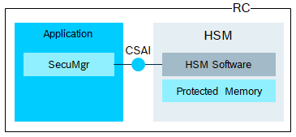
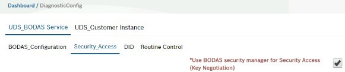
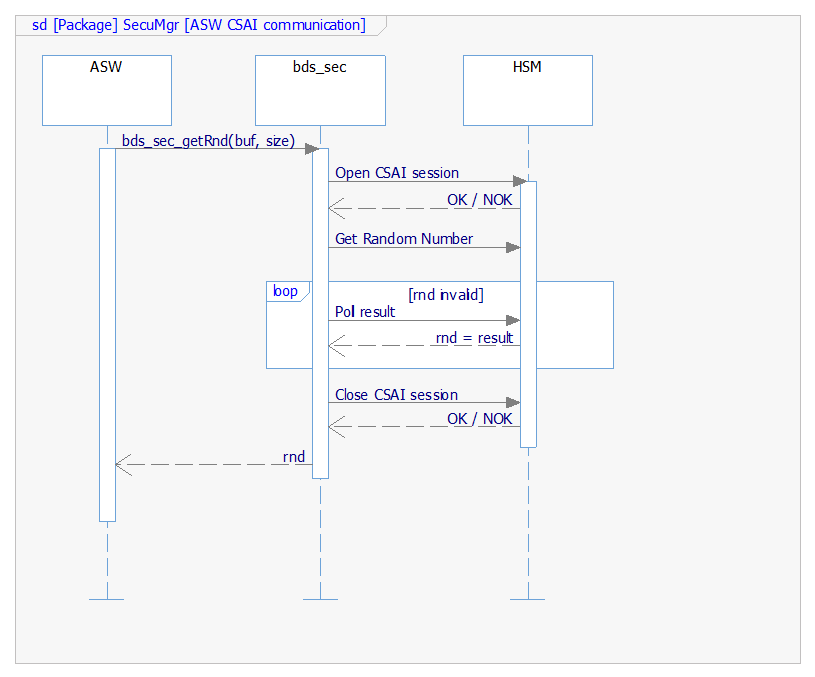

# Security Manager {#security-manager .p_Heading1 style="page-break-after: avoid;"}

+:--------------------------------------------------------------------------------------------------------------------------------------------+-----------------------------------------------------------------------------------------------------------------------------------------------------+
| **Navigation:**  [System features](system-concepts.html) \> [Security](security.html) \> [Security components](security-components.html) \> |    |
|                                                                                                                                             |                                                                                                                                                     |
| # Security Manager {#security-manager-1 .p_Heading1 style="page-break-after: avoid;"}                                                       |                                                                                                                                                     |
+---------------------------------------------------------------------------------------------------------------------------------------------+-----------------------------------------------------------------------------------------------------------------------------------------------------+

The Security Manager is a separate software component provided by the BSW that enables access to the HSM. It handles the management of access levels and provides security-relevant routines that are accessible by the application. In short:

- The component abstracts the communication with the HSM through the Cryptographic Service Application Interface (CSAI).

- The API description for the Security Manager can be found in the  SEC Module section.

- The Security Manager takes part in the UDS key negotiation (see [Authentication](authentication.html){.topiclink}) between tester and RC by default.

- The Security Manager is designed in a way that it can be used with the Rexroth supplied UDS stack as well as a customer specific diagnostic implementation.

<figure style="margin:0;padding:0">

<figcaption>
Figure9: The Security Manager in context with other system components.
</figcaption>
</figure>

## Configuration {#configuration .p_Heading2 style="page-break-after: avoid;"}

The usage of the security manager for UDS can be configured in easyConfig.

- If the option is unchecked, all authorization requests must be handled in the ASW.

- You can still access the Security Manager and use the defined functions in your custom solution (see bds_sec_setLevel).

 

<figure style="margin:0;padding:0">

<figcaption aria-hidden="true">
Figure10: Security Manager configuration in easyConfig.
</figcaption>
</figure>

  ------------------------------------------------------------------------------------------ -------------------------------------------------------------------------------------------------------------------------------------------------------------------------------------------------------
  {style="margin:0;width:2.1667in;height:0.7083in;border:none"}   Customizing the key negotiation procedure is not recommended and should only be done if absolutely necessary. You are responsible for the security of the key negotiation if you disable this option.
  ------------------------------------------------------------------------------------------ -------------------------------------------------------------------------------------------------------------------------------------------------------------------------------------------------------

 

## Component Behavior {#component-behavior .p_Heading2 style="page-break-after: avoid;"}

Functions defined in the  SEC Module provide secure and easy access to cryptographic algorithms that are executed on the HSM. As depicted below, the bds_sec function validates the input parameters and eventually redirects the request to the HSM, which performs the calculation and responds with a positive or negative answer. The answer is delegated back to the original caller of the function.

The Security Manager (bds_sec) wraps the HSM CSAI communication into easy-to-use functions. The HSM routines are executed asynchronously, which means that the result is not directly available after sending the request. The Security Manager transforms the asynchronous call into a synchronous execution by polling for the result.

<figure style="margin:0;padding:0">

<figcaption aria-hidden="true">
Figure11: Exemplary behavior of a bds_sec function. The function coordinates the CSAI session handling that is required for HSM communication.
</figcaption>
</figure>
