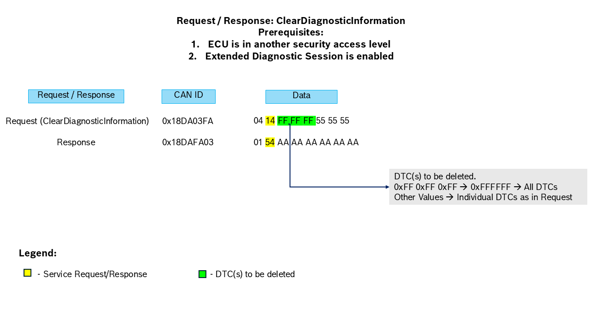

# SID - ClearDiagnosticInformation (0x14) {#sid---cleardiagnosticinformation-0x14 .p_Heading1 style="page-break-after: avoid;"}

+:----------------------------------------------------------------------------------------------------------------------------------------------------------------------------------------------------------------------------------------+--------------------------------------------------------------------------------------------------------------------------------------------------------+
| **Navigation:**  [System features](system-concepts.html) \> [BSW](bsw.html) \> [Diagnostic services (UDS)](diagnostic-services.html) \> [UDS overview](uds---overview.html) \> [Supported UDS services](supported-uds-services.html) \> |   .html "Next Topic") |
|                                                                                                                                                                                                                                         |                                                                                                                                                        |
| # SID - ClearDiagnosticInformation (0x14) {#sid---cleardiagnosticinformation-0x14-1 .p_Heading1 style="page-break-after: avoid;"}                                                                                                       |                                                                                                                                                        |
+-----------------------------------------------------------------------------------------------------------------------------------------------------------------------------------------------------------------------------------------+--------------------------------------------------------------------------------------------------------------------------------------------------------+

This topic explains the service related to Stored data transmission functional unit - ClearDiagnosticInformation.

 

Definition and Short description as per ISO 14229-1:

 

  ---------------------------- ----------------------------------------------------------------------------------------------------------
  Service                      Description
  ClearDiagnosticInformation   Allows the client to clear diagnostic information from the server (including DTCs, captured data, etc.).
  ---------------------------- ----------------------------------------------------------------------------------------------------------

The ClearDiagnosticInformation service is used by the diagnostic tool (client) to clear diagnostic information in one or multiple servers' memory.

Key data which shall be reset of a DTC / all DTCs are:

- DTC status byte (DTC Status)

- Captured DTC snapshot data (Operating Hours and Environment Data)

- Captured DTC extended data (Occurrence Counter)

A sample request and response shall be as follows:

<figure style="margin:0;padding:0">

<figcaption>
Figure 46: Sample Request and Response SID 0x14
</figcaption>
</figure>
