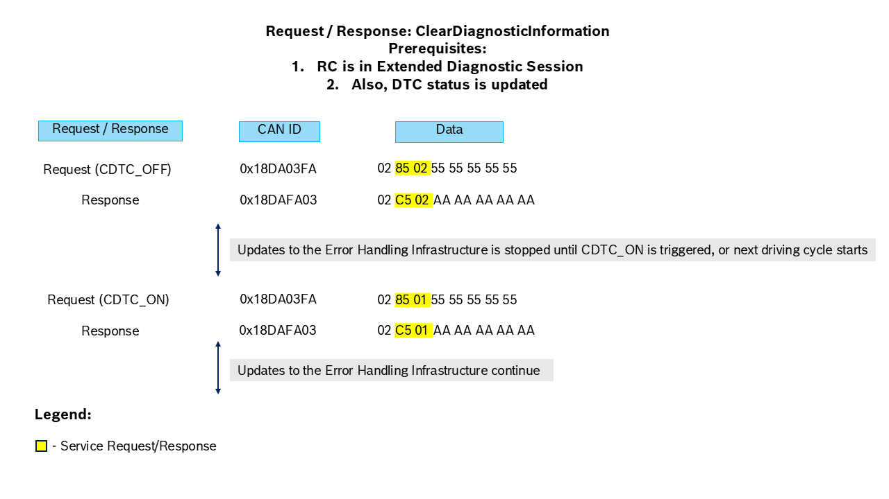

# SID - ControlDTCSetting (0x85) {#sid---controldtcsetting-0x85 .p_Heading1 style="page-break-after: avoid;"}

+:----------------------------------------------------------------------------------------------------------------------------------------------------------------------------------------------------------------------------------------+----------------------------------------------------------------------------------------------------------------------------------------------------------------+
| **Navigation:**  [System features](system-concepts.html) \> [BSW](bsw.html) \> [Diagnostic services (UDS)](diagnostic-services.html) \> [UDS overview](uds---overview.html) \> [Supported UDS services](supported-uds-services.html) \> |    |
|                                                                                                                                                                                                                                         |                                                                                                                                                                |
| # SID - ControlDTCSetting (0x85) {#sid---controldtcsetting-0x85-1 .p_Heading1 style="page-break-after: avoid;"}                                                                                                                         |                                                                                                                                                                |
+-----------------------------------------------------------------------------------------------------------------------------------------------------------------------------------------------------------------------------------------+----------------------------------------------------------------------------------------------------------------------------------------------------------------+

This topic explains the service related to Diagnostic and communication management functional unit - ControlDTCSetting.

 

Definition and Short description as per ISO 14229-1:

 

  ------------------- --------------------------------------------------------
  Service             Description
  ControlDTCSetting   The client controls the setting of DTCs in the server.
  ------------------- --------------------------------------------------------

 

This service has two sub-functions:

- CDTC_ON: DTCSettingType = ON, enables / resumes update of DTC status in the RC (server).

- CDTC_OFF: DTCSettingType = OFF: the RC (server) shall suspend any updates to the DTC status bits (i.e. freeze current values) to Active / Deactive / Previously Active until the functionality is enabled again. After this setting is enabled, DTC status cannot be updated to Active/Previously Active/Deactive until CDTC_ON is triggered or until next driving cycle.

 

Sample request and response shall be as follows:

 

<figure style="margin:0;padding:0">

<figcaption>
Figure 47: Request and response for SID 0x85
</figcaption>
</figure>
