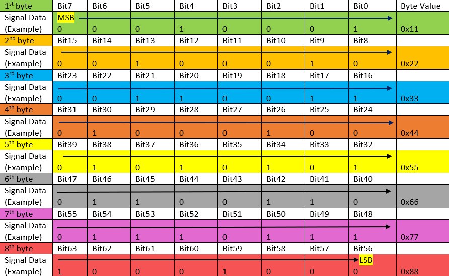
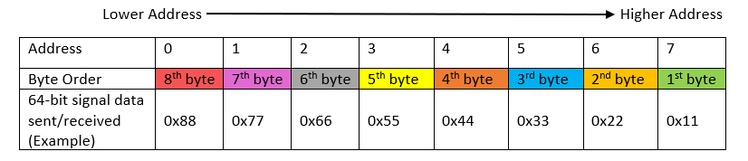
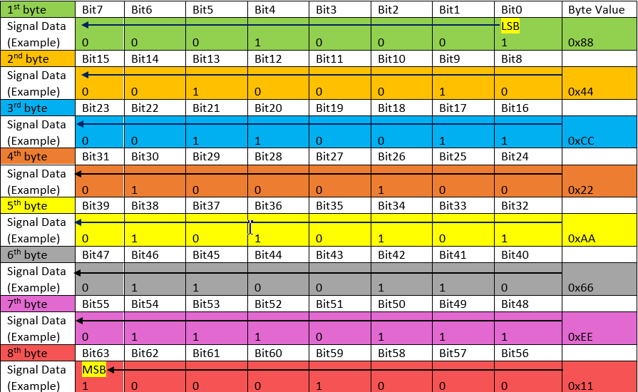
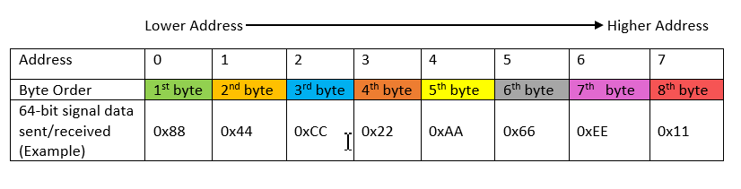

# Signal endianness {#signal-endianness .p_Heading1 style="page-break-after: avoid;"}

+:----------------------------------------------------------------------------------------------------------------------------------------------------------------------+----------------------------------------------------------------------------------------------------------------------------+
| **Navigation:**  [System features](system-concepts.html) \> [BSW](bsw.html) \> [Network communication & protocols](network-comm-protocols.html) \> [CAN](can.html) \> |    |
|                                                                                                                                                                       |                                                                                                                            |
| # Signal endianness {#signal-endianness-1 .p_Heading1 style="page-break-after: avoid;"}                                                                               |                                                                                                                            |
+-----------------------------------------------------------------------------------------------------------------------------------------------------------------------+----------------------------------------------------------------------------------------------------------------------------+

This topic explains the sequence in which signal data bytes are updated in frames based on endianness.

## Remarks {#remarks .p_Heading2 style="page-break-after: avoid;"}

- Endianness of signals which are added manually in eC is little endian.

- Endianness of signals which are imported from DBC is according to the byte order assigned to the signal in DBC i.e.,

   Intel byte order corresponds to little endian signal endianness and Motorola byte order corresponds to big endian signal endianness.

- In Little endian byte order, Signal start position in eC is configured with the LSB bit position of the first byte.

- In Big endian byte order, Signal start position in eC is configured with the MSB bit position of the first byte.

## Big endian (Motorola) byte order {#big-endian-motorola-byte-order .p_Heading2 style="page-break-after: avoid;"}

- For big endian signal endianness, the signal data is transmitted or received in the order as shown in the below figures.

- A signal frame of size 8bytes is populated with big endian signal data in the order (bit 7 -\> bit 0), (bit 15 -\> bit 8), (bit 23 -\> bit 16), (bit 31 -\> bit 24), (bit 39 -\> bit 32), (bit 47-\>bit 40), (bit 55 -\> bit 48), (bit 63 -\> bit 56).

- The most significant byte is stored in the lowest memory address and the least significant byte is stored in the highest memory address.

 

{#fige8886d88 style="margin:0;width:9.2917in;height:5.7083in;border:none"}

[]{#fig_416c05 .hmanchor}Table 10: Big endian byte order

 

{style="margin:0;width:8.6042in;height:1.8542in;border:none"}

[]{#fig_a83165 .hmanchor}Table 11: Big endian byte order (byte wise data)

## Little endian (Intel) byte order {#little-endian-intel-byte-order .p_Heading2 style="page-break-after: avoid;"}

- For little endian signal endianness, the signal data is transmitted or received in the order as shown in the below figures.

- A signal frame of size 8bytes is populated with little endian signal data in the order (bit 0 -\> bit 7), (bit 8 -\> bit 15), (bit 16 -\> bit 23), (bit 24 -\> bit 31), (bit 32 -\> bit 39), (bit 40-\>bit 47), (bit 48 -\> bit 55), (bit 56 -\> bit 63).

- The least significant byte is stored in the lowest memory address and the most significant byte is stored in the highest memory address.

 

{style="margin:0;width:9.3229in;height:5.7292in;border:none"}

[]{#fig_0be53e .hmanchor}Table 12: Little endian byte order

{style="margin:0;width:8.6042in;height:2.1979in;border:none"}

[]{#fig_8d1792 .hmanchor}Table 13: Little endian byte order data (byte wise)

 
