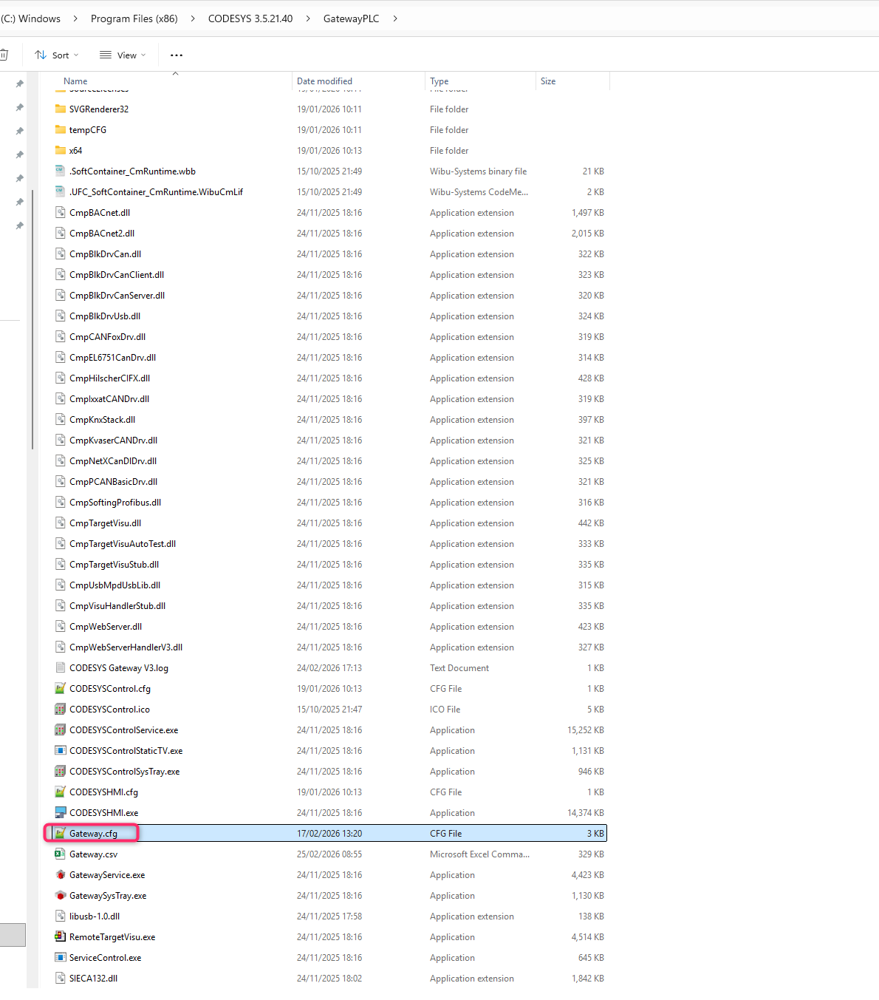

# Step 1: Add Gateway.cfg {#step-1-add-gateway.cfg .p_Heading1 style="page-break-after: avoid;"}

+:------------------------------------------------------------------------------------------------------------------------------------------+------------------------------------------------------------------------------------------------------------------------------+
| **Navigation:**  [Introduction](introduction.html) \> [First steps with RC](preparation.html) \> [Configurations](required-tools.html) \> |    |
|                                                                                                                                           |                                                                                                                              |
| # Step 1: Add Gateway.cfg {#step-1-add-gateway.cfg-1 .p_Heading1 style="page-break-after: avoid;"}                                        |                                                                                                                              |
+-------------------------------------------------------------------------------------------------------------------------------------------+------------------------------------------------------------------------------------------------------------------------------+

Gateway.cfg is a CODESYS Gateway configuration file that contains the communication settings needed for establishing communication between CODESYS IDE & RC4x device.

When CODESYS V3 is installed a default Gateway.cfg will be created in the CODESYS installation directory \<LocalDrive\>/Program Files (x86)/CODESYS 3.5.21.40/GatewayPLC/Gateway.cfg.

The communication settings used by BODAS-RTS to communicate with RC4x are provided in a Gateway.cfg file that is a part of the BODAS-RTS package. (myBODAS build download - BODAS-RTS/GatewayCFG/Gateway.cfg)

Copy/replace the Gateway.cfg file from BODAS-RTS package to CODESYS installation directory \<LocalDrive\>/Program Files (x86)/ GatewayPLC/

 

{style="margin:0;width:11.1979in;height:12.7396in;border:none"}

 

 

 

 

 

  -------------------------------------------------------------------------------- -------------------------------------------------------------------------
  {style="margin:0;width:2.1667in;height:0.6979in;border:none"}   This step is needed for every new installation of CODESYS on a computer
  -------------------------------------------------------------------------------- -------------------------------------------------------------------------
