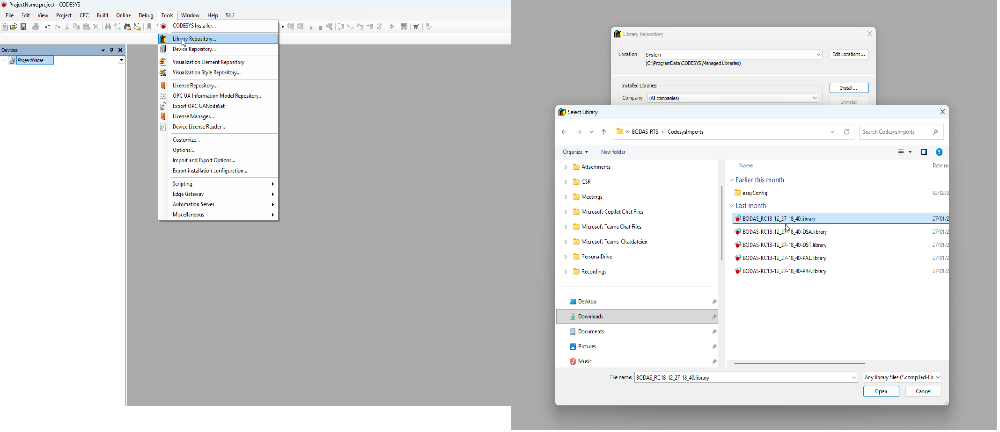

# Step 3: Install library {#step-3-install-library .p_Heading1 style="page-break-after: avoid;"}

+:------------------------------------------------------------------------------------------------------------------------------------------+----------------------------------------------------------------------------------------------------------------------------------------------+
| **Navigation:**  [Introduction](introduction.html) \> [First steps with RC](preparation.html) \> [Configurations](required-tools.html) \> |    |
|                                                                                                                                           |                                                                                                                                              |
| # Step 3: Install library {#step-3-install-library-1 .p_Heading1 style="page-break-after: avoid;"}                                        |                                                                                                                                              |
+-------------------------------------------------------------------------------------------------------------------------------------------+----------------------------------------------------------------------------------------------------------------------------------------------+

All the BODAS-bsw API\'s that are needed for the ASW development are packed in a CODESYS library that can be installed to CODESYS library repository. BODAS-bsw.library is a part of BODAS-RTS package and can be found in myBODAS build download folder in directory - BODAS-RTS/CodesysImports/.

 

Follow the steps below to install BODAS-bsw.library to CODESYS library repository

- Open CODESYS IDE \> Tools \> Library Repository

- After a mini-window will pop-up. in this window click on Install button and browse the library from the downloaded BODAS-RTS package (BODAS-RTS/CodesysImports)

 

{style="margin:0;width:13.2500in;height:5.7292in;border:none"}

 

 

  -------------------------------------------------------------------------------- ----------------------------------------------------
  {style="margin:0;width:2.1667in;height:0.6979in;border:none"}   This step is needed for every new Workflow release
  -------------------------------------------------------------------------------- ----------------------------------------------------
