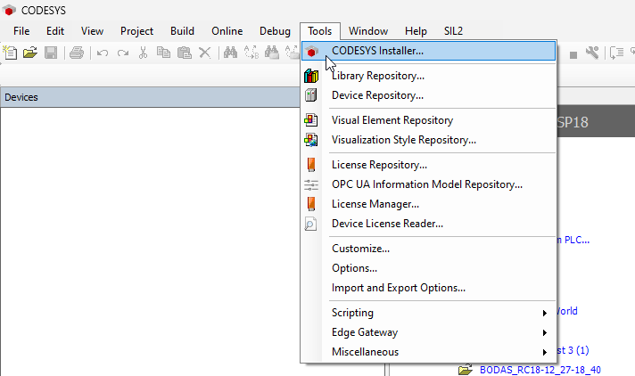
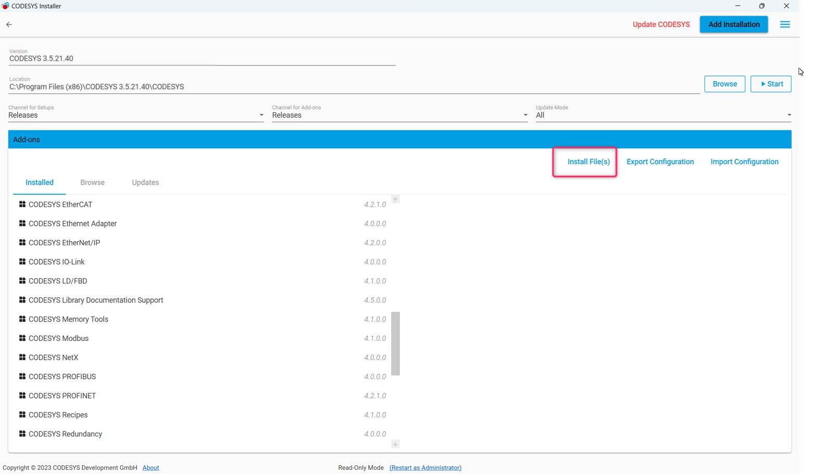
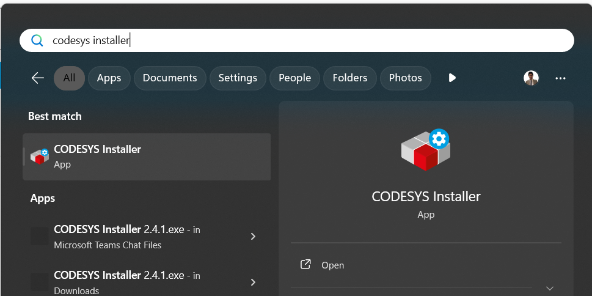

# Step 4: Install additional plug-ins {#step-4-install-additional-plug-ins .p_Heading1 style="page-break-after: avoid;"}

+:------------------------------------------------------------------------------------------------------------------------------------------+-----------------------------------------------------------------------------------------------------------------------------------------------+
| **Navigation:**  [Introduction](introduction.html) \> [First steps with RC](preparation.html) \> [Configurations](required-tools.html) \> |    |
|                                                                                                                                           |                                                                                                                                               |
| # Step 4: Install additional plug-ins {#step-4-install-additional-plug-ins-1 .p_Heading1 style="page-break-after: avoid;"}                |                                                                                                                                               |
+-------------------------------------------------------------------------------------------------------------------------------------------+-----------------------------------------------------------------------------------------------------------------------------------------------+

 

BODAS-RTS package includes AdditionalPlugIns.zip that contains:

- Bodas Files Generation.package: a package that provides Rexroth specific feature, to generate hex and a2l files for application SW directly from CODESYS IDE.

- CODESYS Safety SIL2 3.5.21.0.package: a package from CODESYS that enables writing application with mixed safety critical SW.

To install these plug-ins to CODESYS, the following steps have to be followed:

- Open CODESYS IDE \> Tools \> CODESYS Installer

- After a mini-window will pop-up. In this window click on Change button then Install File(s) and browse the .package files from the downloaded BODAS-RTS package (BODAS-RTS/CodesysImports/AdditionalPlugins.zip)

{style="margin:0;width:10.4479in;height:6.1875in;border:none"}{style="margin:0;width:10.9271in;height:6.3750in;border:none"}

- The plugins can also be installed via the CODESYS Installer without the need to open CODESYS IDE

{style="margin:0;width:10.0938in;height:5.0417in;border:none"}

 

 

  -------------------------------------------------------------------------------- ----------------------------------------------------
  {style="margin:0;width:2.1667in;height:0.6979in;border:none"}   This step is needed for every new Workflow release
  -------------------------------------------------------------------------------- ----------------------------------------------------
