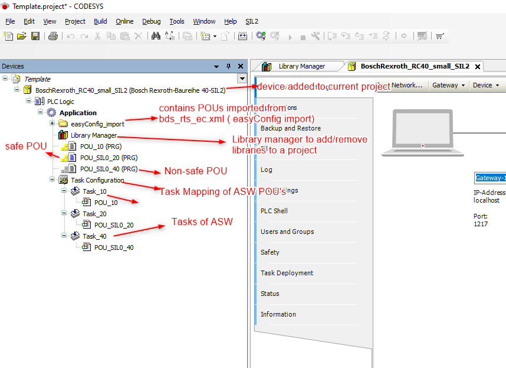

# Step 5: ASW development & involved components {#step-5-asw-development-involved-components .p_Heading1 style="page-break-after: avoid;"}

+:---------------------------------------------------------------------------------------------------------------------------------------------+--------------------------------------------------------------------------------------------------------------------------------------------------------+
| **Navigation:**  [Introduction](introduction.html) \> [First steps with RC](preparation.html) \> [Configurations](required-tools.html) \>    |    |
|                                                                                                                                              |                                                                                                                                                        |
| # Step 5: ASW development & involved components {#step-5-asw-development-involved-components-1 .p_Heading1 style="page-break-after: avoid;"} |                                                                                                                                                        |
+----------------------------------------------------------------------------------------------------------------------------------------------+--------------------------------------------------------------------------------------------------------------------------------------------------------+

The below picture details the main components of ASW development using CODESYS and BODAS-RTS

 

 

<figure style="margin:0;padding:0">

<figcaption aria-hidden="true">
CODESYS ASW components
</figcaption>
</figure>

 

Each element is detailed in this chapter and its sub-chapters

 

 
