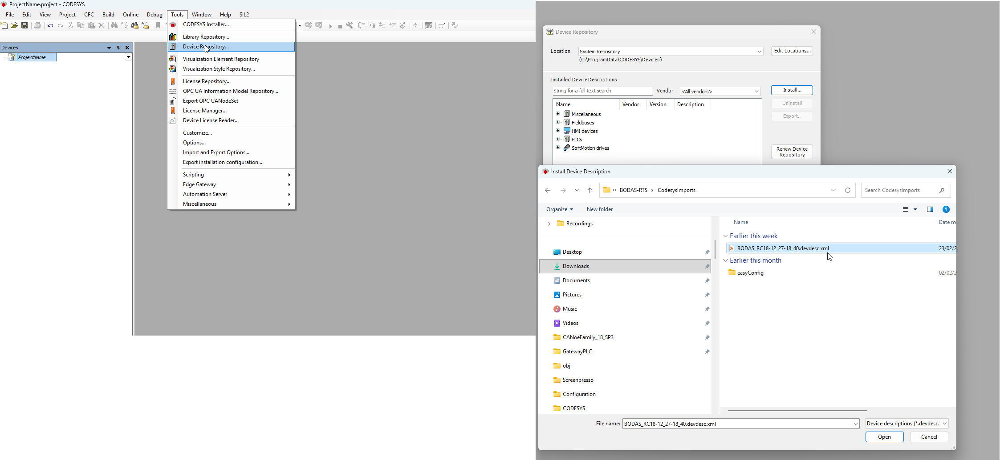

# Step3: Install Device {#step3-install-device .p_Heading1 style="page-break-after: avoid;"}

+:------------------------------------------------------------------------------------------------------------------------------------------+---------------------------------------------------------------------------------------------------------------------------------------+
| **Navigation:**  [Introduction](introduction.html) \> [First steps with RC](preparation.html) \> [Configurations](required-tools.html) \> |    |
|                                                                                                                                           |                                                                                                                                       |
| # Step3: Install Device {#step3-install-device-1 .p_Heading1 style="page-break-after: avoid;"}                                            |                                                                                                                                       |
+-------------------------------------------------------------------------------------------------------------------------------------------+---------------------------------------------------------------------------------------------------------------------------------------+

RC4x device must be installed to the CODESYS device repository using the xml file which contains all the information needed for CODESYS to generate executable code for the target (RC4x device). The device description carries the following information to CODESYS IDE:

- memory configurations of the target device

- device ID, device name, device architecture

- configurable CODESYS feature set,

- library name & version info, etc

Follow the steps below to install RC4x device to device repository:

- Open CODESYS IDE \> Tools \> Device Repository

- After a mini-window will pop-up. In this window click on Install button and browsw the xml file with name BoschRexroth_RC40-small_devicedesc.xml from the downloaded BODAS-RTS package (BODAS-RTS/CodesysImports)

 

{style="margin:0;width:13.5625in;height:6.2500in;border:none"}

 

  -------------------------------------------------------------------------------- ----------------------------------------------------
  {style="margin:0;width:2.1667in;height:0.6979in;border:none"}   This step is needed for every new Workflow release
  -------------------------------------------------------------------------------- ----------------------------------------------------
