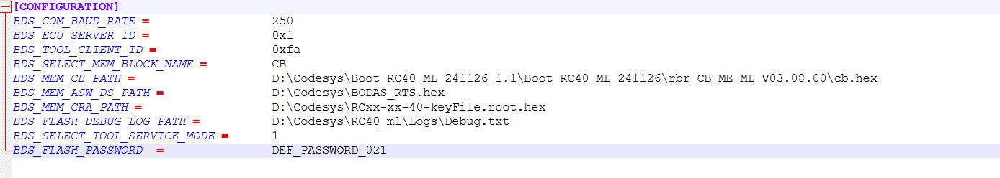
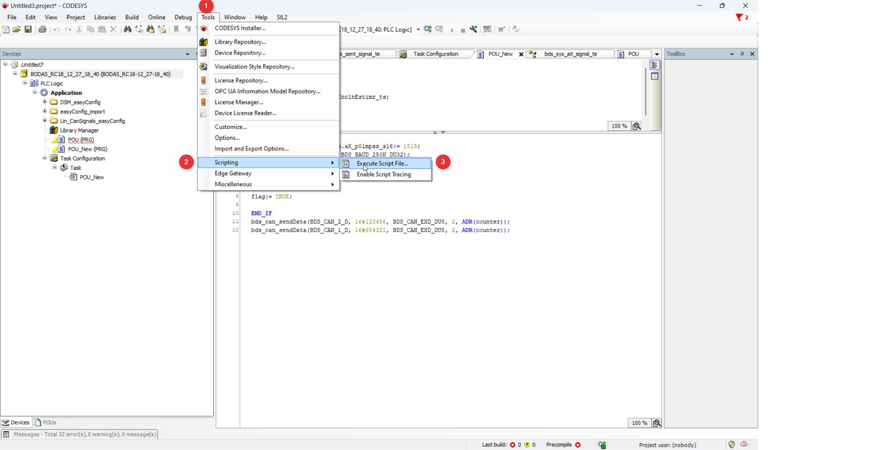
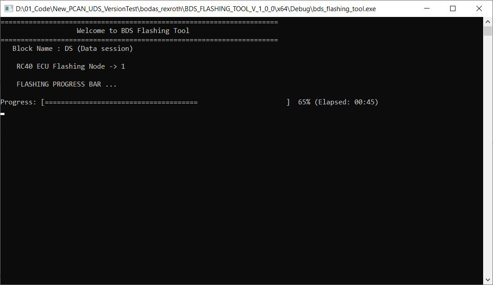
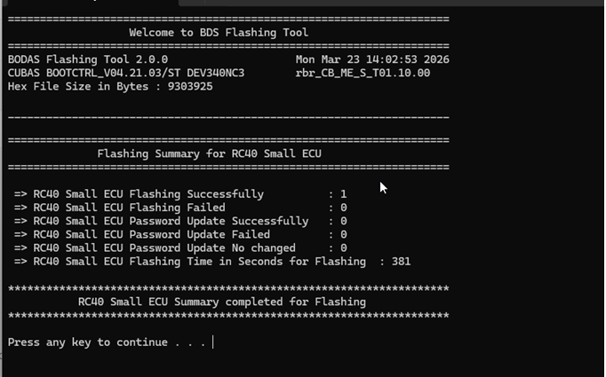
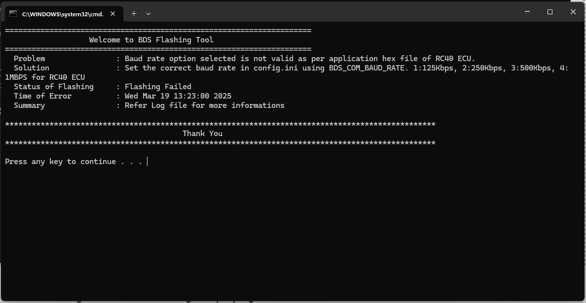

# Flashing using BDS Flashing tool in CODESYS {#flashing-using-bds-flashing-tool-in-codesys .p_Heading1 style="page-break-after: avoid;"}

 

+:-------------------------------------------------------------------------------------------------------------------------------------------------------------------------+----------------------------------------------------------------------------------------------------------------------------------------------------+
| **Navigation:**  [How-Tos](how-to.html) \> [Flashing using CODESYS IDE](required-tools_2.html) \> [BDS Flashing Tool Scope of Features](step-3install-library_2.html) \> |    |
|                                                                                                                                                                          |                                                                                                                                                    |
| # Flashing using BDS Flashing tool in CODESYS {#flashing-using-bds-flashing-tool-in-codesys-1 .p_Heading1 style="page-break-after: avoid;"}                              |                                                                                                                                                    |
|                                                                                                                                                                          |                                                                                                                                                    |
|                                                                                                                                                                          |                                                                                                                                                    |
+--------------------------------------------------------------------------------------------------------------------------------------------------------------------------+----------------------------------------------------------------------------------------------------------------------------------------------------+

Step 1: Configure the config.ini with the merged hex file including the codesys app

{style="margin:0;width:14.4583in;height:2.5833in;border:none"}

 

Step 2: Open CODESYS IDE → (1)Tools → (2)Scripting → (3)Execute Script file → Browse the python script inside the BDS Flashing Tool (flash_script.py)

{style="margin:0;width:18.7813in;height:9.5000in;border:none"}

                                                                                 Flashing in CODESYS IDE

A command line window opens when flashing starts. The flashing progress is shown if the configuration is correct.

 

{style="margin:0;width:11.4896in;height:6.6563in;border:none"}

                                                         Flashing Progress

If flashing is successful, the following log will be shown.

 

{style="margin:0;width:7.1042in;height:4.4271in;border:none"}

                                                         Flashing Done

 

If any error occurs during the flashing, the error will be displayed on the console as shown below.

{style="margin:0;width:11.4479in;height:5.9271in;border:none"}

 

 

 

 
