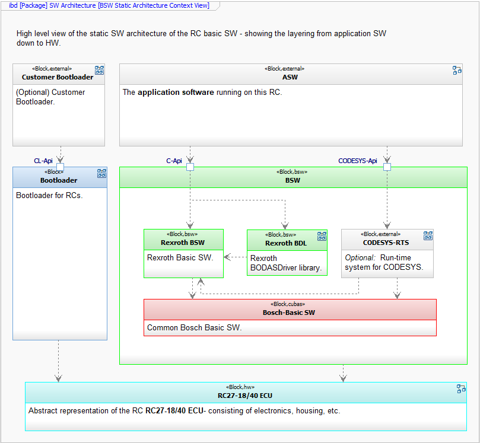

# SW architecture overview {#sw-architecture-overview .p_Heading1 style="page-break-after: avoid;"}

+:-------------------------------------------------------------------------------------------------------+-----------------------------------------------------------------------------------------------------------------------------------+
| **Navigation:**  [System features](system-concepts.html) \> [SW architecture](sw-architecture.html) \> |    |
|                                                                                                        |                                                                                                                                   |
| # SW architecture overview {#sw-architecture-overview-1 .p_Heading1 style="page-break-after: avoid;"}  |                                                                                                                                   |
+--------------------------------------------------------------------------------------------------------+-----------------------------------------------------------------------------------------------------------------------------------+

On the topmost level the SW running on the RC is structured as follows:

<figure style="margin:0;padding:0">

<figcaption aria-hidden="true">
Figure 29: Software architecture overview
</figcaption>
</figure>

 

From a high level view, the RC SW architecture consists of the following parts:

oThe application software (ASW)

oThe basic software (BSW) consisting of:

§The Rexroth BSW and BODAS Driver library (BDL) providing RC specific functionality and the C-Api for the ASW

§A common Bosch Basic SW (based on an AUTOSAR stack) providing basic drivers and infrastructure

§The CODESYS runtime (optionally for CODESYS enabled RCs)

oA separate boot-application consisting of:

§A common Rexroth bootloader (CB-ME: Customer Bootloader - Mobile Electronics)

§Optional: a customer bootloader connected via the CLAPI

 

 
