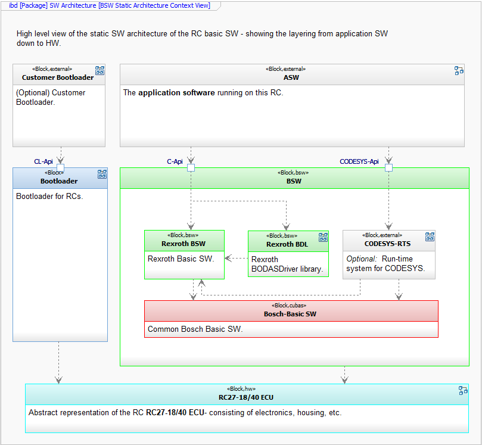

# Software overview {#software-overview .p_Heading1 style="page-break-after: avoid;"}

+:----------------------------------------------------------------------------------------+----------------------------------------------------------------------------------------------------------------------------+
| **Navigation:**  [Introduction](introduction.html) \>                                   |    |
|                                                                                         |                                                                                                                            |
| # Software overview {#software-overview-1 .p_Heading1 style="page-break-after: avoid;"} |                                                                                                                            |
+-----------------------------------------------------------------------------------------+----------------------------------------------------------------------------------------------------------------------------+

RCs are designed as freely programmable hardware platforms. They can be programmed:

- In the programming language C

- In the programming system CODESYS

- Via model based development (e.g., MATLAB and Simulink) using a C code generator

In all cases Rexroth provides a programming interface (API) to set up the application:

<figure style="margin:0;padding:0">

<figcaption aria-hidden="true">
Figure4: API_ArchTopLevelView
</figcaption>
</figure>

 

Both C and CODESYS API then use:

- The Rexroth Basic SW which provides features specific for our environment (see [Applications)](application.html){.topiclink}

- The Common Bosch Basis SW - a Bosch wide used, automotive grade basis SW that provides features like µC drivers, memory handling, etc.

See [SW Architecture](sw-architecture.html){.topiclink} for more details.

 

+------------------------------------------------------------------------------------------+--------------------------------------------------------------------------------------------------------------------------------+
| {style="margin:0;width:2.1667in;height:0.7083in;border:none"} | The BSW does not run independently.                                                                                            |
|                                                                                          |                                                                                                                                |
|                                                                                          | •It must be configured for the specific ECU and needs a minimum application and a local build in order to generate a hex file. |
|                                                                                          |                                                                                                                                |
|                                                                                          | •That hex file is then flashed to run on the ECU.                                                                              |
|                                                                                          |                                                                                                                                |
|                                                                                          | See [the BODAS EcoSystem](ecosystem.html){.topiclink} for more details.                                                        |
+------------------------------------------------------------------------------------------+--------------------------------------------------------------------------------------------------------------------------------+

 
