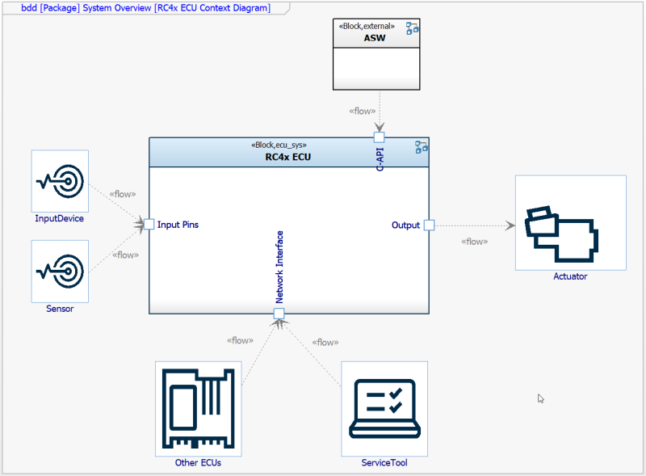

# System overview {#system-overview .p_Heading1 style="page-break-after: avoid;"}

+:------------------------------------------------------------------------------------+----------------------------------------------------------------------------------------------------------------+
| **Navigation:**  [Introduction](introduction.html) \>                               |    |
|                                                                                     |                                                                                                                |
| # System overview {#system-overview-1 .p_Heading1 style="page-break-after: avoid;"} |                                                                                                                |
+-------------------------------------------------------------------------------------+----------------------------------------------------------------------------------------------------------------+

An RC is designed as universal ECU for mobile working machines. It is used for the programmable control of proportional and switching solenoids as well as additional electrical switching functions. Typical applications are electro-hydraulically actuated work functions, travel drives and transmission controls.

<figure style="margin:0;padding:0">

<figcaption aria-hidden="true">
Figure5: System delivery scope
</figcaption>
</figure>

RCs offer the following functionality:

- Reading different types of input devices (e.g., Sensors or Joysticks, via multipurpose HW ports)

- Controlling different types of output devices (e.g., PWM or current controlled)

- Sending and receiving of network messages (e.g., CAN).

- Writing and reading of non-volatile data contents

- Turning on and off of supply voltages to the RC

- Methods for data security (e.g., secure storage, true random numbers)

- Reliable self monitoring for safety relevant applications (e.g., operation of watchdogs)

 

 

 
