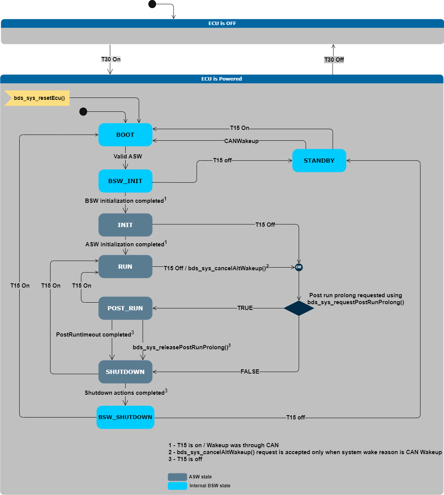

# System state machine {#system-state-machine .p_Heading1 style="page-break-after: avoid;"}

+:------------------------------------------------------------------------------------------------------------------------------------------------------+-------------------------------------------------------------------------------------------------------------------------------------------------------------------+
| **Navigation:**  [System features](system-concepts.html) \> [BSW](bsw.html) \> [Runtime system & system states](runtime-system-system-states.html) \> |    |
|                                                                                                                                                       |                                                                                                                                                                   |
| # System state machine {#system-state-machine-1 .p_Heading1 style="page-break-after: avoid;"}                                                         |                                                                                                                                                                   |
+-------------------------------------------------------------------------------------------------------------------------------------------------------+-------------------------------------------------------------------------------------------------------------------------------------------------------------------+

+------------------------------------------------------------------------------------------+----------------------------------------------------------------------------------------------------------------------------------+
| {style="margin:0;width:2.1667in;height:0.7083in;border:none"} | •The RC4x system supports new state machine behavior from workflow  s/MLs80.rts onwards.                                         |
|                                                                                          |                                                                                                                                  |
|                                                                                          | •[legacy state machine](system-state-machine---legacy.html){.topiclink} behavior is also supported for backward compatibility.   |
|                                                                                          |                                                                                                                                  |
|                                                                                          | •Users can choose their preferred state machine behavior using easyConfig.                                                       |
|                                                                                          |                                                                                                                                  |
|                                                                                          | •By default, the new state machine behavior is active and recommended for new projects.                                          |
|                                                                                          |                                                                                                                                  |
|                                                                                          | •For detailed instructions on configurations and backward compatibility handling of eC projects, refer to the easyConfig manual. |
+------------------------------------------------------------------------------------------+----------------------------------------------------------------------------------------------------------------------------------+
| \                                                                                        |                                                                                                                                  |
+------------------------------------------------------------------------------------------+----------------------------------------------------------------------------------------------------------------------------------+

## Power supply state {#power-supply-state .p_Heading2 style="page-break-after: avoid;"}

In the RC4x system, two power supply states are possible.

+--------------------------------------------------------------+------------------------------------------------------------------------------------------+
| OFF state                                                    | POWERED state                                                                            |
+--------------------------------------------------------------+------------------------------------------------------------------------------------------+
| In this state,                                               | In this state,                                                                           |
|                                                              |                                                                                          |
| §T30/T31 is not connected to the battery.                    | §The ECU is powered by T30/T31.                                                          |
|                                                              |                                                                                          |
| §ECU is not powered and power consumption of the ECU is 0mA. | §The POWERED state consists of several software states.                                  |
|                                                              |                                                                                          |
| §Software is not executing.                                  | §Software is executing (except in STANDBY state)                                         |
|                                                              |                                                                                          |
|                                                              | §Power consumption depends on the internal software state and active software functions. |
|                                                              |                                                                                          |
|                                                              | •In STANDBY state, power consumption of the ECU is \<1mA.                                |
|                                                              |                                                                                          |
|                                                              | •In all other states, power consumption of the ECU is \>100mA.                           |
+--------------------------------------------------------------+------------------------------------------------------------------------------------------+

The diagram below illustrates the states of the RC4x system state machine and their transitions.

{style="margin:0;width:10.7917in;height:12.0313in;border:none"}

## Software states {#software-states .p_Heading2 style="page-break-after: avoid;"}

The above state diagram shows that the powered state comprises several software states. The RC4x system supports 8 software states, with some indicating BSW internal states and others indicating ASW states. The API  bds_sys_getStates returns only the ASW state.

### States {#states .p_Heading3 style="page-break-after: avoid;"}

  ---------------- -------------------- ------------- --------------------------------
  Software State   Type of State        ASW Running   bds_sys_getStates Return value
  BOOT             Internal BSW state   No            \-
  STANDBY          Internal BSW state   No            \-
  BSW_INIT         Internal BSW state   No            \-
  INIT             ASW state            Yes           BDS_SYSSTATE_INIT_E
  RUN              ASW state            Yes           BDS_SYSSTATE_RUN_E
  POST_RUN         ASW state            Yes           BDS_SYSSTATE_POSTRUN_E
  SHUTDOWN         ASW state            Yes           BDS_SYSSTATE_SHUTDOWN_E
  BSW_SHUTDOWN     Internal BSW state   No            \-
  ---------------- -------------------- ------------- --------------------------------

### Events {#events .p_Heading3 style="page-break-after: avoid;"}

The transition between the states are controlled by below events.

1.T15: This refers to the hardware status of the T15 pin, which is based on the ignition switch connection. For more detailed information, please refer to the controller datasheet.

2.CAN wakeup message: For more details, refer to the section on [Wakeup by CAN.](wakeup-by-can.html){.topiclink}

3.BSW API: Some transitions can be controlled by Basic Software (BSW) APIs and can be managed by Application Software (ASW) as needed. e.g:  bds_sys_cancelAltWakeup,  bds_sys_requestPostRunProlong,  bds_sys_releasePostRunProlong,  bds_sys_resetEcu.

### State Actions and Transitions {#state-actions-and-transitions .p_Heading3 style="page-break-after: avoid;"}

+----------------------+---------------------------------------------------------------------------------------------------------------------------+------------------------------------------------------------------------------------------------------------------------------------------------------------------------------+--------------------------+---------------------------------------------------+
| State Name           | Actions                                                                                                                   | Transitions                                                                                                                                                                  | Power Outputs Status     | Diagnosis of Power Outputs                        |
+----------------------+---------------------------------------------------------------------------------------------------------------------------+------------------------------------------------------------------------------------------------------------------------------------------------------------------------------+--------------------------+---------------------------------------------------+
| BOOT                 | •Boot control (BootCtrl) is executed                                                                                      | This state is entered under any of the following conditions:                                                                                                                 | Off                      | No diagnosis                                      |
|                      |                                                                                                                           |                                                                                                                                                                              |                          |                                                   |
|                      | •Customer Bootblock (CB) is executed                                                                                      | •Initially at power-on.                                                                                                                                                      |                          |                                                   |
|                      |                                                                                                                           |                                                                                                                                                                              |                          |                                                   |
|                      | •Optionally Customer loader (CL) is executed.                                                                             | •When a software reset occurs ( bds_sys_resetEcu).                                                                                                                           |                          |                                                   |
|                      |                                                                                                                           |                                                                                                                                                                              |                          |                                                   |
|                      |                                                                                                                           | •When T15 is on.                                                                                                                                                             |                          |                                                   |
|                      |                                                                                                                           |                                                                                                                                                                              |                          |                                                   |
|                      |                                                                                                                           | •Upon a CAN wake-up event.                                                                                                                                                   |                          |                                                   |
|                      |                                                                                                                           |                                                                                                                                                                              |                          |                                                   |
|                      |                                                                                                                           |                                                                                                                                                                              |                          |                                                   |
|                      |                                                                                                                           |                                                                                                                                                                              |                          |                                                   |
|                      |                                                                                                                           | This state is exited to only one state, BSW_INIT, provided that the software is valid (i.e., a valid hex file containing both BSW and ASW is flashed).                       |                          |                                                   |
+----------------------+---------------------------------------------------------------------------------------------------------------------------+------------------------------------------------------------------------------------------------------------------------------------------------------------------------------+--------------------------+---------------------------------------------------+
| STANDBY              | •ECU is in sleep state and software is not running.                                                                       | The state is transitioned to the BOOT state for one of the below events                                                                                                      | Off                      | No diagnosis                                      |
|                      |                                                                                                                           |                                                                                                                                                                              |                          |                                                   |
|                      | •The Power consumption of the ECU is less than 1mA.                                                                       | •T15 is on.                                                                                                                                                                  |                          |                                                   |
|                      |                                                                                                                           |                                                                                                                                                                              |                          |                                                   |
|                      | •Monitoring for CAN wakeup event is activated.                                                                            | •Upon a CAN wake-up event.                                                                                                                                                   |                          |                                                   |
+----------------------+---------------------------------------------------------------------------------------------------------------------------+------------------------------------------------------------------------------------------------------------------------------------------------------------------------------+--------------------------+---------------------------------------------------+
| BSW_INIT             | •Initialization of RAM sections                                                                                           | One of the below transitions can occur:                                                                                                                                      | Off                      | No diagnosis                                      |
|                      |                                                                                                                           |                                                                                                                                                                              |                          |                                                   |
|                      | •Initialization of hardware drivers                                                                                       | •After completion of BSW initialization this state is transitioned to INIT state provided that T15 is on or Wakeup was through CAN                                           |                          |                                                   |
|                      |                                                                                                                           |                                                                                                                                                                              |                          |                                                   |
|                      | •Initialization of operating system                                                                                       | •If the T15 is off, the state is transitioned to STANDBY                                                                                                                     |                          |                                                   |
|                      |                                                                                                                           |                                                                                                                                                                              |                          |                                                   |
|                      | •Initialization of all BSW modules                                                                                        |                                                                                                                                                                              |                          |                                                   |
|                      |                                                                                                                           |                                                                                                                                                                              |                          |                                                   |
|                      | •Apply configuration from easyConfig                                                                                      |                                                                                                                                                                              |                          |                                                   |
|                      |                                                                                                                           |                                                                                                                                                                              |                          |                                                   |
|                      | •Validate and restore marked NVM blocks                                                                                   |                                                                                                                                                                              |                          |                                                   |
|                      |                                                                                                                           |                                                                                                                                                                              |                          |                                                   |
|                      | •Restore operating hours from NVM                                                                                         |                                                                                                                                                                              |                          |                                                   |
|                      |                                                                                                                           |                                                                                                                                                                              |                          |                                                   |
|                      | •Enable outputs for control                                                                                               |                                                                                                                                                                              |                          |                                                   |
|                      |                                                                                                                           |                                                                                                                                                                              |                          |                                                   |
|                      | •Initialization of watchdog                                                                                               |                                                                                                                                                                              |                          |                                                   |
+----------------------+---------------------------------------------------------------------------------------------------------------------------+------------------------------------------------------------------------------------------------------------------------------------------------------------------------------+--------------------------+---------------------------------------------------+
| INIT                 | •All application process configured for application init task (OsIniProc) are executed sequentially.                      | One of the below transitions can occur:                                                                                                                                      | Can be controlled by ASW | No diagnosis, Configuration of diagnosis possible |
|                      |                                                                                                                           |                                                                                                                                                                              |                          |                                                   |
|                      | •The cyclic tasks of application software is not running in this state.                                                   | •After completion of ASW initialization this state is transitioned to RUN state provided that T15 is on or Wakeup was through CAN.                                           |                          |                                                   |
|                      |                                                                                                                           |                                                                                                                                                                              |                          |                                                   |
|                      |                                                                                                                           | •If the wake was not through CAN and T15 is off, the state is transitioned to POST_RUN if bds_sys_requestPostRunProlong is called else the state is transitioned to SHUTDOWN |                          |                                                   |
|                      |                                                                                                                           |                                                                                                                                                                              |                          |                                                   |
|                      |                                                                                                                           |                                                                                                                                                                              |                          |                                                   |
|                      |                                                                                                                           |                                                                                                                                                                              |                          |                                                   |
|                      |                                                                                                                           | Note: During the transition event, the ongoing ASW process is completed before transitioning from this state                                                                 |                          |                                                   |
+----------------------+---------------------------------------------------------------------------------------------------------------------------+------------------------------------------------------------------------------------------------------------------------------------------------------------------------------+--------------------------+---------------------------------------------------+
| RUN                  | •All application process configured for cyclic tasks are running.                                                         | One of the below transitions can occur:                                                                                                                                      | Can be controlled by ASW | Yes, as configured by ASW,                        |
|                      |                                                                                                                           |                                                                                                                                                                              |                          |                                                   |
|                      |                                                                                                                           |                                                                                                                                                                              |                          | Re-configuration possible                         |
|                      |                                                                                                                           |                                                                                                                                                                              |                          |                                                   |
|                      |                                                                                                                           | If bds_sys_requestPostRunProlong was called                                                                                                                                  |                          |                                                   |
|                      |                                                                                                                           |                                                                                                                                                                              |                          |                                                   |
|                      |                                                                                                                           | •The state is transitioned to POST_RUN for one of the below events                                                                                                           |                          |                                                   |
|                      |                                                                                                                           |                                                                                                                                                                              |                          |                                                   |
|                      |                                                                                                                           | oIf wakeup was through T15 and not CAN,  and if T15 is off                                                                                                                   |                          |                                                   |
|                      |                                                                                                                           |                                                                                                                                                                              |                          |                                                   |
|                      |                                                                                                                           | oIf wakeup was through CAN, if API bds_sys_cancelAltWakeup is called                                                                                                         |                          |                                                   |
|                      |                                                                                                                           |                                                                                                                                                                              |                          |                                                   |
|                      |                                                                                                                           |                                                                                                                                                                              |                          |                                                   |
|                      |                                                                                                                           |                                                                                                                                                                              |                          |                                                   |
|                      |                                                                                                                           | If bds_sys_requestPostRunProlong was not called                                                                                                                              |                          |                                                   |
|                      |                                                                                                                           |                                                                                                                                                                              |                          |                                                   |
|                      |                                                                                                                           | •The state is transitioned to SHUTDOWN for one of the below events                                                                                                           |                          |                                                   |
|                      |                                                                                                                           |                                                                                                                                                                              |                          |                                                   |
|                      |                                                                                                                           | oIf wakeup was through T15 and not CAN,  and if T15 is off                                                                                                                   |                          |                                                   |
|                      |                                                                                                                           |                                                                                                                                                                              |                          |                                                   |
|                      |                                                                                                                           | oIf wakeup was through CAN and if API bds_sys_cancelAltWakeup is called                                                                                                      |                          |                                                   |
|                      |                                                                                                                           |                                                                                                                                                                              |                          |                                                   |
|                      |                                                                                                                           |                                                                                                                                                                              |                          |                                                   |
|                      |                                                                                                                           |                                                                                                                                                                              |                          |                                                   |
|                      |                                                                                                                           | Note: During the transition event, the ongoing ASW process is completed before transitioning from this state                                                                 |                          |                                                   |
+----------------------+---------------------------------------------------------------------------------------------------------------------------+------------------------------------------------------------------------------------------------------------------------------------------------------------------------------+--------------------------+---------------------------------------------------+
| POST_RUN             | •All application process configured for cyclic tasks with post run enabled are running.                                   | One of the below transitions can occur:                                                                                                                                      | Can be controlled by ASW | Yes, as configured by ASW,                        |
|                      |                                                                                                                           |                                                                                                                                                                              |                          |                                                   |
|                      |                                                                                                                           | •The state is transitioned to RUN state if T15 is ON.                                                                                                                        |                          | Re-configuration possible                         |
|                      |                                                                                                                           |                                                                                                                                                                              |                          |                                                   |
|                      |                                                                                                                           | •The state is transitioned to SHUTDOWN for one the below events                                                                                                              |                          |                                                   |
|                      |                                                                                                                           |                                                                                                                                                                              |                          |                                                   |
|                      |                                                                                                                           | oPost Run timeout is completed                                                                                                                                               |                          |                                                   |
|                      |                                                                                                                           |                                                                                                                                                                              |                          |                                                   |
|                      |                                                                                                                           | oAPI bds_sys_releasePostRunProlong was called                                                                                                                                |                          |                                                   |
|                      |                                                                                                                           |                                                                                                                                                                              |                          |                                                   |
|                      |                                                                                                                           |                                                                                                                                                                              |                          |                                                   |
|                      |                                                                                                                           |                                                                                                                                                                              |                          |                                                   |
|                      |                                                                                                                           | Note: During the transition event, the ongoing ASW process is completed before transitioning from this state                                                                 |                          |                                                   |
+----------------------+---------------------------------------------------------------------------------------------------------------------------+------------------------------------------------------------------------------------------------------------------------------------------------------------------------------+--------------------------+---------------------------------------------------+
| SHUTDOWN (AFTER_RUN) | •All application cyclic tasks are disabled.                                                                               | One of the below transitions can occur:                                                                                                                                      | Can be controlled by ASW | Yes, as configured by ASW,                        |
|                      |                                                                                                                           |                                                                                                                                                                              |                          |                                                   |
|                      | •All application process configured for application shutdown task are executed sequentially.                              | •The state is transitioned to RUN state if T15 is ON.\                                                                                                                       |                          | Re-configuration possible                         |
|                      |                                                                                                                           | Note: BSW operations mentioned (NVM saving, switching off outputs etc.,) will be executed before transitioning to RUN state.                                                 |                          |                                                   |
|                      | Note: After application Shutdown process is completed, BSW will execute below operations before moving out of this state: |                                                                                                                                                                              |                          |                                                   |
|                      |                                                                                                                           | •The state is transitioned to BSW_SHUTDOWN after completion of executing all the process in ASW shutdown task.                                                               |                          |                                                   |
|                      | •BSW internal data stored into NVM (eg- Operating hours, UDS configurations)                                              |                                                                                                                                                                              |                          |                                                   |
|                      |                                                                                                                           |                                                                                                                                                                              |                          |                                                   |
|                      | •Data of NVM blocks commanded by bds_mem_markBlock is stored.                                                             |                                                                                                                                                                              |                          |                                                   |
|                      |                                                                                                                           | Note:                                                                                                                                                                        |                          |                                                   |
|                      | •Switch off SAFEOUT channels                                                                                              |                                                                                                                                                                              |                          |                                                   |
|                      |                                                                                                                           | 1.During the transition event, the ongoing ASW process is completed before transitioning from this state                                                                     |                          |                                                   |
|                      | •Switch off outputs                                                                                                       |                                                                                                                                                                              |                          |                                                   |
|                      |                                                                                                                           | 2.This state is also referred to as AFTER_RUN                                                                                                                                |                          |                                                   |
+----------------------+---------------------------------------------------------------------------------------------------------------------------+------------------------------------------------------------------------------------------------------------------------------------------------------------------------------+--------------------------+---------------------------------------------------+
| BSW_SHUTDOWN         | •Prepare RC for going to STANDBY mode, i.e., shutting down software and peripherals before going to STANDBY mode.         | One of the below transitions can occur:                                                                                                                                      | Off                      | No diagnosis                                      |
|                      |                                                                                                                           |                                                                                                                                                                              |                          |                                                   |
|                      |                                                                                                                           | •The state is transitioned to BOOT state if T15 is ON.                                                                                                                       |                          |                                                   |
|                      |                                                                                                                           |                                                                                                                                                                              |                          |                                                   |
|                      |                                                                                                                           | •The state is transitioned to STANDBY after completion of executing all the BSW shutdown actions.                                                                            |                          |                                                   |
+----------------------+---------------------------------------------------------------------------------------------------------------------------+------------------------------------------------------------------------------------------------------------------------------------------------------------------------------+--------------------------+---------------------------------------------------+

###   {#section .p_Heading3 style="page-break-after: avoid;"}

 
