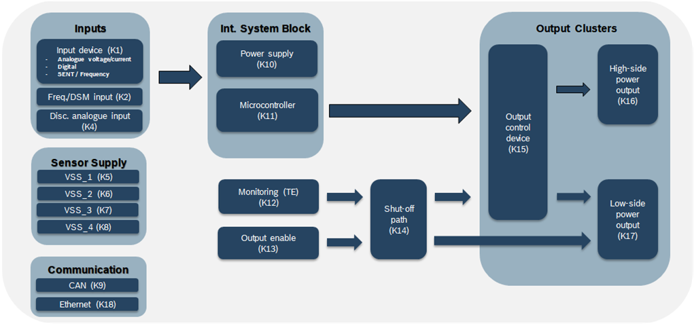
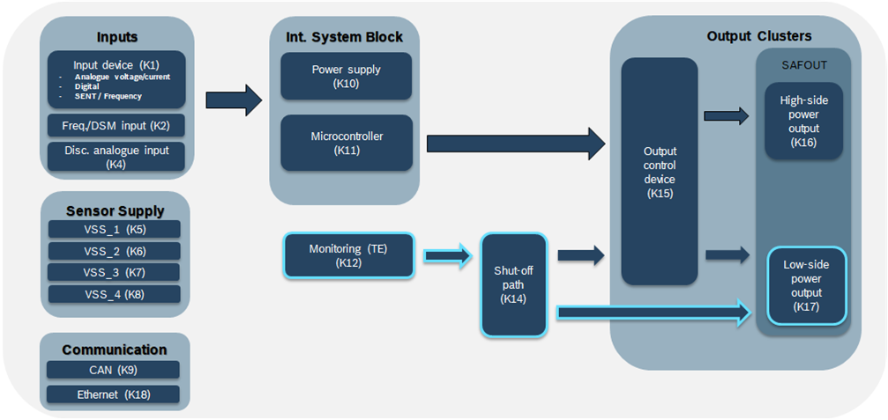
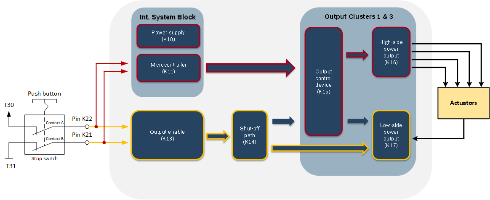

# Safety modules in the system architecture {#safety-modules-in-the-system-architecture .p_Heading1 style="page-break-after: avoid;"}

+:----------------------------------------------------------------------------------------------------------------------------------------+---------------------------------------------------------------------------------------------------------------------------------------------------+
| **Navigation:**  [Safety manual](safety-manual.html) \> [Safety-related functions](safety-relatedfunctions.html) \>                     |    |
|                                                                                                                                         |                                                                                                                                                   |
| # Safety modules in the system architecture {#safety-modules-in-the-system-architecture-1 .p_Heading1 style="page-break-after: avoid;"} |                                                                                                                                                   |
+-----------------------------------------------------------------------------------------------------------------------------------------+---------------------------------------------------------------------------------------------------------------------------------------------------+

The design of the RCs adopts the module-based approach. The function groups with safety-related modules of the RC are illustrated in the following Figure.    

<figure style="margin:0;padding:0">

<figcaption aria-hidden="true">
Figure 114:  RC18-12/40 and RC27-18/40 safety-related modules
</figcaption>
</figure>

 

 

The safety function 1 (system integrity) is implemented with a Category 2 architecture (see the following figure), where "Inputs \--\> Int. System Block \--\> Output cluster" form the main channel, while  "Monitoring \--\> Shut-OFF Path \--\> Low-side power outputs" works as the testing channel.

<figure style="margin:0;padding:0">

<figcaption aria-hidden="true">
Figure 115: RC18-12/20 and RC27-18/40 system architecture for safety function 1 (system integrity)
</figcaption>
</figure>

 

For RC18-12/40 and RC27-18/40, the safety function 2 (external stop switch) fulfills the requirements of Category 3 architecture, as illustrated in the following figure. If the external stop switch is pressed, the actuators that are connected following safe output configurations (see [Safety-related outputs ─ power outputs in safe output configuration](safety-relatedoutputs.html){.topiclink}) with

-cluster 1 power outputs of the RC18-12/40,

-cluster 1 or cluster 3 power outputs of the RC27-18/40

will be switched off redundantly.

The switching off is performed on one way via "(Stop switch) \--\> Int. System Block \--\> Output control device \--\> High-side power outputs", and parallel on another way via "(Stop switch) \--\> Output enable \--\> Shut-OFF path \--\> Low-side power outputs".

<figure style="margin:0;padding:0">

<figcaption aria-hidden="true">
Figure 116: RC18-12/40 and RC27-18/40 system architecture for safety function 2 (external stop switch)
</figcaption>
</figure>

 

 

 
