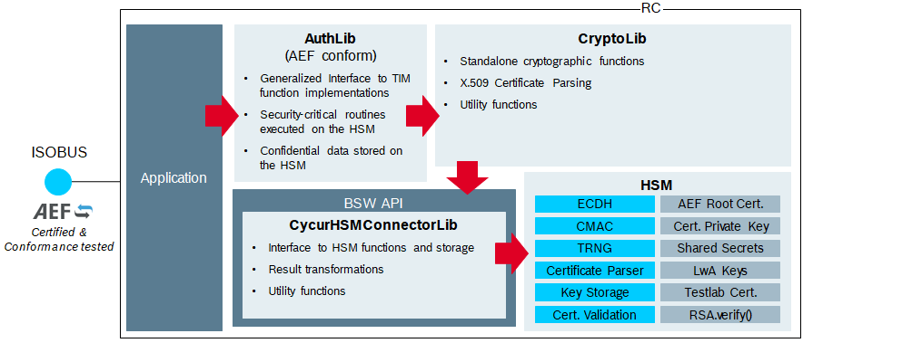

# TIM on RC4x {#tim-on-rc4x .p_Heading1 style="page-break-after: avoid;"}

+:-----------------------------------------------------------------------------------------------------------------------------------------------------------------------------------------------------------------------+---------------------------------------------------------------------------------------------------------------------------------------+
| **Navigation:**  [System features](system-concepts.html) \> [Security](security.html) \> [Security components](security-components.html) \> [Tractor Implement Management (TIM)](tractor-implement-management.html) \> |    |
|                                                                                                                                                                                                                        |                                                                                                                                       |
| # TIM on RC4x {#tim-on-rc4x-1 .p_Heading1 style="page-break-after: avoid;"}                                                                                                                                            |                                                                                                                                       |
+------------------------------------------------------------------------------------------------------------------------------------------------------------------------------------------------------------------------+---------------------------------------------------------------------------------------------------------------------------------------+

The RC is TIM-ready by default. However, you need to acquire third-party material like digital certificates and recent guideline-conform software implementations to use this feature. This section describes required and available components and provides a general overview of security related aspects for TIM on the RC.

<figure style="margin:0;padding:0">

<figcaption aria-hidden="true">
Figure14: Overview of the AuthLib and its components.
</figcaption>
</figure>

The figure above shows the required software modules and HSM features that ensure a secure implementation and storage of confidential information on the RC. The CycurHSMConnectorLib is included within the BSW that can be configured using easyConfig. The HSM software provides all security relevant procedures that are required for the authentication process.

 

The Authentication Library (\"AuthLib\") usually consists of two separate components. The AuthLib provides an AEF-conform API that can be used to access library features. The CryptoLib provides cryptographic functions that are used by the AuthLib as well as utility functions for establishing a secure authentication between two parties. Additionally, the CryptoLib contains a stand-alone implementation of cryptographic functions that can be used when no HSM is available.

 

  ------------------------------------------------------------------------------------------ ------------------------------------------------------------------------------------------------------------------------------------------------------------------------------------------------------------------------------
  {style="margin:0;width:2.1667in;height:0.7083in;border:none"}   The AuthLib and CryptoLib have to be configured to be used together with the HSM that is present in the RC manually. If this is not configured, all security-critical TIM-related functions will not be executed on the HSM.
  ------------------------------------------------------------------------------------------ ------------------------------------------------------------------------------------------------------------------------------------------------------------------------------------------------------------------------------

 

We recommend you to follow the following steps to realize TIM on the RC.

## 1. Order a licensing model from the AEF {#order-a-licensing-model-from-the-aef .p_Heading2 style="page-break-after: avoid;"}

The [Agricultural Industry Electronics Foundation (AEF)](https://www.aef-online.org/){.weblink target="_blank"} (external link) is an independent organization that serves as a central [Certification Authority](x509certificates.html){.topiclink} and is responsible for certifying and distributing digital certificates to interested vendors. You will require a digital series certificate from the AEF for every device on which you want to use the TIM feature. Without these certificates, you will not be able to successfully negotiate a trust basis with any other machines that support TIM via AEF.

 

We highly recommend that you order your certificates from the [ITK Engineering GmbH](https://www.itk-engineering.de/){.weblink target="_blank"} (external link) as this will give you access to an adapted version of the authentication library that is specially designed to be used together with a [Hardware Security Module (HSM)](hardware-security-module.html){.topiclink} and may contain code extensions that are adjusted for RC-specific use.

## 2. Acquire or develop an ISOBUS stack implementation {#acquire-or-develop-an-isobus-stack-implementation .p_Heading2 style="page-break-after: avoid;"}

Rexroth does not offer a TIM-conform ISOBUS stack for the RC. You can use the API (see [ISOBUS/J1939](isobus-module.html){.topiclink}) to implement or adapt a TIM-conform stack.

## 3. Acquire an Authentication Library (AuthLib) {#acquire-an-authentication-library-authlib .p_Heading2 style="page-break-after: avoid;"}

The [authentication library](configuring-the-authlib.html){.topiclink} is a third-party utility API that provides a common implementation of the standard across different vendors. This API is described in-depth by AEF guidelines and developed by AEF-certified partners. By acquiring AEF series certificates, you will receive a copy of the Authentication Library that you can use together with the RC.

## 4. Become AEF certified {#become-aef-certified .p_Heading2 style="page-break-after: avoid;"}

To make sure that your device is AEF-conform, you need to certify it before it is productively used. The AEF offers conformance tests and a number of other products that can help you to achieve a successful certification.
