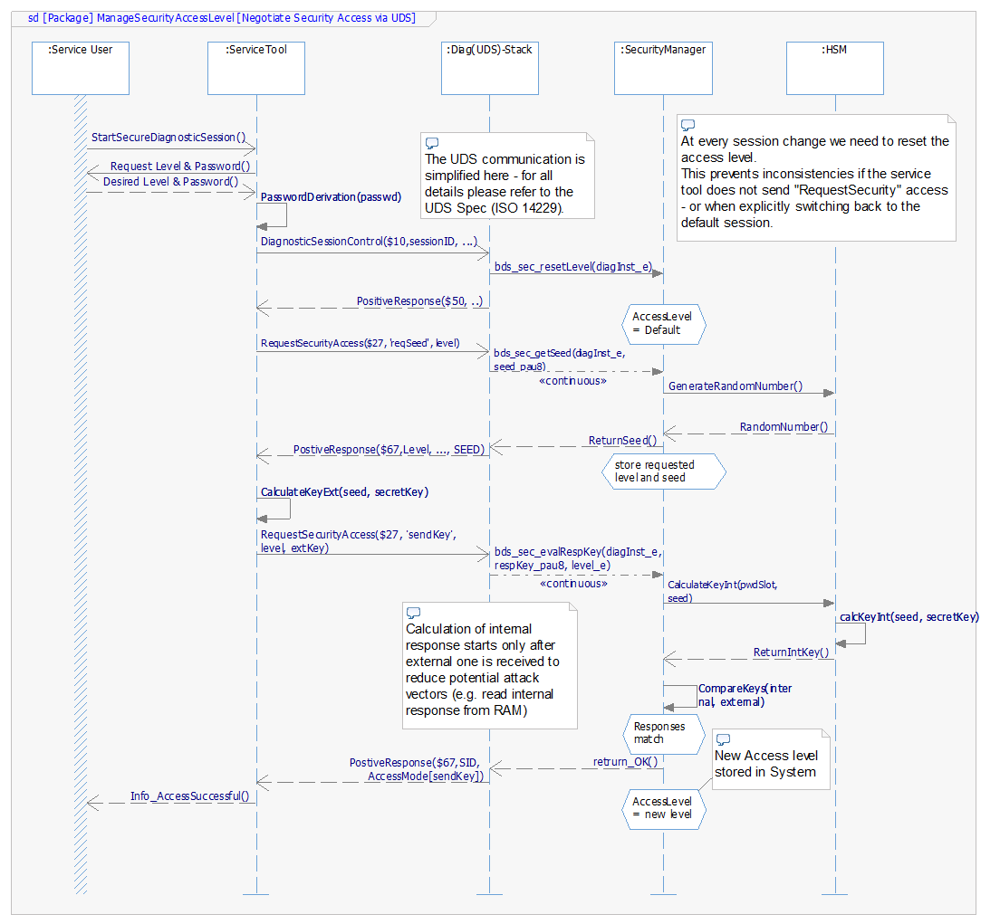

# UDS security access {#uds-security-access .p_Heading1 style="page-break-after: avoid;"}

+:-------------------------------------------------------------------------------------------------------------------------------------------------------------------------------------------------+-----------------------------------------------------------------------------------------------------------------------------------------+
| **Navigation:**  [System features](system-concepts.html) \> [Security](security.html) \> [Authentication](authentication.html) \> [Diagnostic authentication](diagnostic-authentication.html) \> |    |
|                                                                                                                                                                                                  |                                                                                                                                         |
| # UDS security access {#uds-security-access-1 .p_Heading1 style="page-break-after: avoid;"}                                                                                                      |                                                                                                                                         |
+--------------------------------------------------------------------------------------------------------------------------------------------------------------------------------------------------+-----------------------------------------------------------------------------------------------------------------------------------------+

The security access via UDS is activated by default. There are no additional actions required by the user since the Security Manager handles the security access by itself by using the functions included in the  SEC module.

<figure style="margin:0;padding:0">

<figcaption aria-hidden="true">
Figure24:  Detailed security access when using the default procedures for the authentication process.
</figcaption>
</figure>
