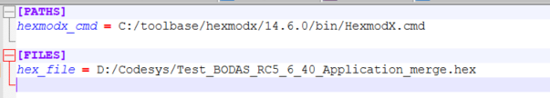
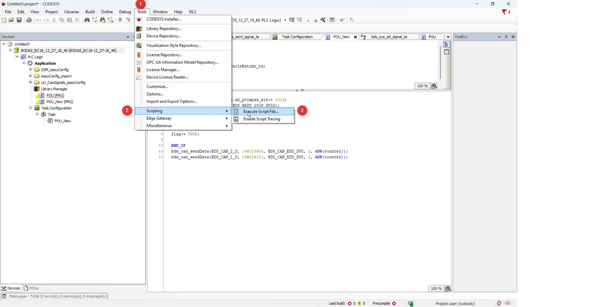
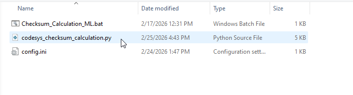
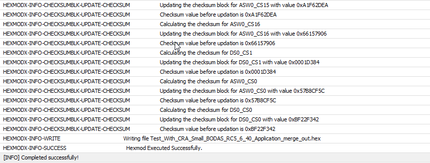

# Usage of Checksum Calculation Tool {#usage-of-checksum-calculation-tool .p_Heading1 style="page-break-after: avoid;"}

+:--------------------------------------------------------------------------------------------------------------------------------------+------------------------------------------------------------------------------------------------------------------------------------------------------------------------+
| **Navigation:**  [How-Tos](how-to.html) \> [How to calculate checksum for CODESYS merged HEX](how-to-calculate-checksum-for-.html) \> |    |
|                                                                                                                                       |                                                                                                                                                                        |
| # Usage of Checksum Calculation Tool {#usage-of-checksum-calculation-tool-1 .p_Heading1 style="page-break-after: avoid;"}             |                                                                                                                                                                        |
+---------------------------------------------------------------------------------------------------------------------------------------+------------------------------------------------------------------------------------------------------------------------------------------------------------------------+

 \
 

+------------------------------------------------------------------------------------------+------------------------------------------------------+
| {style="margin:0;width:2.1667in;height:0.7083in;border:none"} | The following files should exist in the same folder: |
|                                                                                          |                                                      |
|                                                                                          | oBatch script to perform Hexmodx operations          |
|                                                                                          |                                                      |
|                                                                                          | oPython script                                       |
|                                                                                          |                                                      |
|                                                                                          | oConfig.ini to configure:                            |
|                                                                                          |                                                      |
|                                                                                          | §Path of hexmodx tool                                |
|                                                                                          |                                                      |
|                                                                                          | §Hex file to be flashed                              |
+------------------------------------------------------------------------------------------+------------------------------------------------------+

 \
 

  -------------------------------------------------------------------------------- -----------------------------------------------------------------------------
  {style="margin:0;width:2.1667in;height:0.6979in;border:none"}   Do not change the name of the batch file which performs Hexmodx operations.
  -------------------------------------------------------------------------------- -----------------------------------------------------------------------------

 

  -------------------------------------------------------------------------------- -------------------------------------------------------------------------------------------------------------------------------------------------
  {style="margin:0;width:2.1667in;height:0.6979in;border:none"}   Checksum calculation procedure enlarges HEX file as checksum is calculated on the whole PFLASH, this leads to an increase in the flashing time.
  -------------------------------------------------------------------------------- -------------------------------------------------------------------------------------------------------------------------------------------------

 

Step 1: Configure the config.ini with the path of the ASW merged hex file including the CODESYS app and path of Hexmodx tool.

Note: To merge the hex file please refer to [Build ASW and generate hex](build-asw-and-generate-hex.html){.topiclink}.\
 \
Path to config.ini : D:/Codesys/delivery/tools/Checksum_Calculation_Tool/config.ini\
 \
{style="margin:0;width:6.2813in;height:1.1250in;border:none"}

 

Step 2: Open CODESYS IDE → Tools → Scripting → Execute Script file → Browse the python script inside the Checksum Calculation Tool(codesys_checksum_calculation.py)\
 \
{style="margin:0;width:13.9375in;height:7.0521in;border:none"}

 \
 \
Step 3: Select and double click on the Python source file codesys_checksum_calculation.py from Checksum_Calculation_Tool\
 \
Path to python script :  D:/Codesys/delivery/tools/Checksum_Calculation_Tool/codesys_checksum_calculation.py\
{style="margin:0;width:7.3646in;height:1.9896in;border:none"}\
 \
If Hexmodx operation is successful, the following log will be shown in CODESYS IDE

{style="margin:0;width:8.9479in;height:3.3854in;border:none"}

 

 

 \
 
