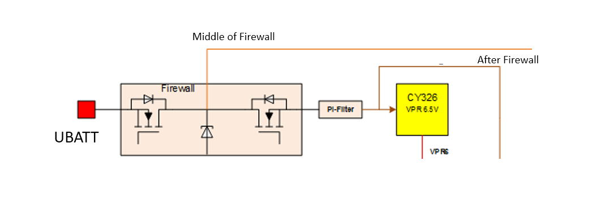

# VKL30 after the HW-Firewall via Input device S4800 {#vkl30-after-the-hw-firewall-via-input-device-s4800 .p_Heading1 style="page-break-after: avoid;"}

+:------------------------------------------------------------------------------------------------------------------------------------------------------------------------------------+--------------------------------------------------------------------------------------------------------------------------------------------------------+
| **Navigation:**  [System features](system-concepts.html) \> [BSW](bsw.html) \> [Self-monitoring](ecu-self-monitoring.html) \> [Cyclic monitoring](cyclic-monitoring-checks.html) \> |    |
|                                                                                                                                                                                     |                                                                                                                                                        |
| # VKL30 after the HW-Firewall via Input device S4800 {#vkl30-after-the-hw-firewall-via-input-device-s4800-1 .p_Heading1 style="page-break-after: avoid;"}                           |                                                                                                                                                        |
+-------------------------------------------------------------------------------------------------------------------------------------------------------------------------------------+--------------------------------------------------------------------------------------------------------------------------------------------------------+

The cyclic check of the ECU power supply KL30 after the HW-firewall via Input device S4800.

The \"HW-firewall\" is a protection circuitry in the supply path of the ECU.

 

<figure style="margin:0;padding:0">

<figcaption aria-hidden="true">
Figure54: Block diagram of UBATT firewall
</figcaption>
</figure>

## Remarks: {#remarks .p_Heading2 style="page-break-after: avoid;"}

- Monitoring of overvoltage for error.

- Only Error are indicated.

- Over Voltage Error Limit = 38.700V.

- If the VKL30 is greater than 34.500V and less than 38.700V for more than 5 minutes of duration then the Over Voltage Error for Long time will be set.

- Refer [Safety function and safe state](safetyfunctionandsafestate.html){.topiclink} for details on the safety functions provided by the RCs and the related considerations to be observed.

- Refer [Failure detection possibilities](failuredetectionpossibilities.html){.topiclink} for a broader overview of the different failure reactions observed.

 

Error Reaction:

 

- Over Voltage Error

  Error Description              Reaction
  ------------------------------ ----------------------------
  DFC                            DFC_rbr_mo_OV_UBRM24_LOADS
  Error Code                     0x080C00
  Error parameter                1
  High Power Outputs(\...,OFF)   yes
  ECU Reset                      no
  Reaction time                  1000ms

 

- Over Voltage Error for Long time

  Error Description              Reaction
  ------------------------------ ----------------------------
  DFC                            DFC_rbr_mo_OV_UBRM24_LOADS
  Error Code                     0x080C00
  Error parameter                2
  High Power Outputs(\...,OFF)   yes
  ECU Reset                      no
  Reaction time                  1000ms

 

 
