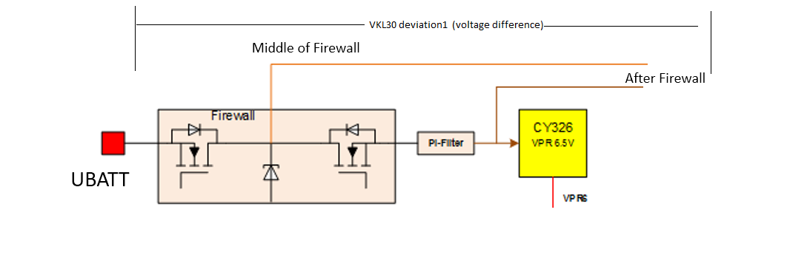

# VKL30 deviation 1 {#vkl30-deviation-1 .p_Heading1 style="page-break-after: avoid;"}

+:------------------------------------------------------------------------------------------------------------------------------------------------------------------------------------+---------------------------------------------------------------------------------------------------------------------------------------------------------------------------+
| **Navigation:**  [System features](system-concepts.html) \> [BSW](bsw.html) \> [Self-monitoring](ecu-self-monitoring.html) \> [Cyclic monitoring](cyclic-monitoring-checks.html) \> |    |
|                                                                                                                                                                                     |                                                                                                                                                                           |
| # VKL30 deviation 1 {#vkl30-deviation-1-1 .p_Heading1 style="page-break-after: avoid;"}                                                                                             |                                                                                                                                                                           |
+-------------------------------------------------------------------------------------------------------------------------------------------------------------------------------------+---------------------------------------------------------------------------------------------------------------------------------------------------------------------------+

The cyclic check of the voltage difference between ECU power supply KL30 and KL30 after the HW-Firewall via Input device.

The \"HW-firewall\" is a protection circuitry in the supply path of the ECU.

 

<figure style="margin:0;padding:0">

<figcaption aria-hidden="true">
Figure55: Block diagram of VKL30 deviation 1
</figcaption>
</figure>

 

## Remarks: {#remarks .p_Heading2 style="page-break-after: avoid;"}

- Monitoring of voltage difference for error.

- If the voltage difference between KL30 and KL30 after the HW-Firewall via Input device is 3.100V then the voltage difference error will be set.

- Refer [Safety function and safe state](safetyfunctionandsafestate.html){.topiclink} for details on the safety functions provided by the RCs and the related considerations to be observed.

- Refer [Failure detection possibilities](failuredetectionpossibilities.html){.topiclink} for a broader overview of the different failure reactions observed.

 

Error Reaction:

- Voltage Difference Error

  Error                          Reaction
  ------------------------------ -----------------------
  DFC                            DFC_rbr_mo_DvUBAT_FWs
  Error Code                     0x080D00
  High Power Outputs(\...,OFF)   no
  ECU Reset                      no
  Reaction time                  200ms
