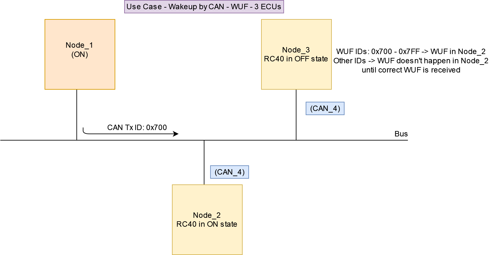
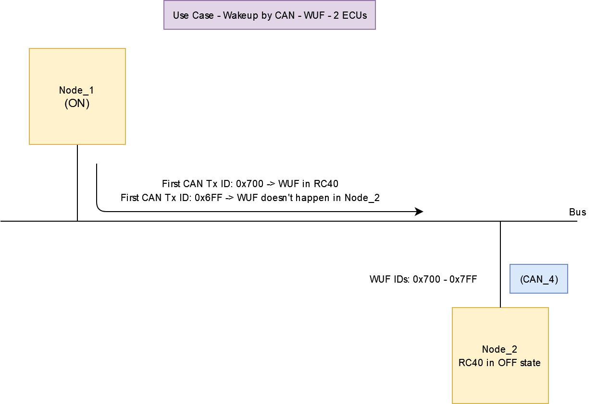

# Wakeup by Frame (WUF) {#wakeup-by-frame-wuf .p_Heading1 style="page-break-after: avoid;"}

+:--------------------------------------------------------------------------------------------------------------------------------------------------------------------------------------------------------------------------------+---------------------------------------------------------------------------------------------------------------------------------------------------------------------+
| **Navigation:**  [System features](system-concepts.html) \> [BSW](bsw.html) \> [Runtime system & system states](runtime-system-system-states.html) \> [Wake up](wake-up-feature.html) \> [Wakeup by CAN](wakeup-by-can.html) \> |   .html "Next Topic") |
|                                                                                                                                                                                                                                 |                                                                                                                                                                     |
| # Wakeup by Frame (WUF) {#wakeup-by-frame-wuf-1 .p_Heading1 style="page-break-after: avoid;"}                                                                                                                                   |                                                                                                                                                                     |
+---------------------------------------------------------------------------------------------------------------------------------------------------------------------------------------------------------------------------------+---------------------------------------------------------------------------------------------------------------------------------------------------------------------+

The ECU wakes up if a specific CAN frame is received multiple times cyclically, with a cycle time greater than or equal to 1 ms, when the WUF mechanism is activated.

The wakeup frame is configured in easyConfig (refer [Parameter Configuration in eC (CAN wakeup)](configuration-parameters-required-for-wakeup-by-can.html){.topiclink}).

## Prerequisites for Wakeup by Frame (WUF): {#prerequisites-for-wakeup-by-frame-wuf .p_Heading2 style="page-break-after: avoid;"}

- Wakeup by Frame is configured in easyConfig.

- T15 is off and ECU is in STANDBY state.

- There is at least one ECU connected to CAN_4 that can send wakeup frames.

## Scenario at which CAN WUF happens: {#scenario-at-which-can-wuf-happens .p_Heading2 style="page-break-after: avoid;"}

The ECU wakes up by WUF if the prerequisites are met and the ECU received a valid CAN wakeup frame.

Here a valid CAN wakeup frame is a CAN message with:

 a) a valid ID as configured in easyConfig

 b) a valid DLC as configured in easyConfig.

 c) a valid data in synchronization with the Data mask as configured in easyConfig.

 d) a baud rate as same as configured in easyConfig.

### Scenario 1: More than two nodes in CAN network {#scenario-1-more-than-two-nodes-in-can-network .p_Heading3 style="page-break-after: avoid;"}

There are three nodes in a CAN network (Node_1 sends CAN messages, Node_2 is ON and doesn't send any CAN message, and Node_3 is RC4x selective CAN ECU).

<figure style="margin:0;padding:0">

<figcaption aria-hidden="true">
Figure100: Example for wakeup by CAN (WUF) for three ECUs
</figcaption>
</figure>

- If ECU receives multiple valid CAN wakeup frames at the beginning, ECU wakes up by WUF.

- If the first frame received by the ECU is invalid, then the ECU doesn\'t wake up by WUF. ECU wakes up only after receiving multiple valid CAN wakeup frames.

## Scenarios at which CAN WUF does not happen, though configured, but WUP happens: {#scenarios-at-which-can-wuf-does-not-happen-though-configured-but-wup-happens .p_Heading2 style="page-break-after: avoid;"}

### Scenario 1: Unintended wakeup due to CAN communication errors {#scenario-1-unintended-wakeup-due-to-can-communication-errors .p_Heading3 style="page-break-after: avoid;"}

- If the CAN transceiver receives a CAN message containing errors then WUP may happen automatically (instead of WUF) as transceiver can\'t recognize the CAN frame received.

+------------------------------------------------------------------------------------------------------------------------------------------------------------+
| {style="margin:0;width:8.3333in;height:0.4479in;border:none"}                                                                         |
+============================================================================================================================================================+
| •If the baud rate is changed dynamically using BSW API bds_can_init, ensure that baud rate should be same as configured in easyConfig before ECU shutdown. |
|                                                                                                                                                            |
| •Otherwise, ECU wakes up unexpectedly when it receives baud rate mismatch error frames.                                                                    |
+------------------------------------------------------------------------------------------------------------------------------------------------------------+

## Scenarios at which CAN WUF does not happen due to invalid CAN wakeup frame received: {#scenarios-at-which-can-wuf-does-not-happen-due-to-invalid-can-wakeup-frame-received .p_Heading2 style="page-break-after: avoid;"}

### Scenario 1: Two nodes in CAN network {#scenario-1-two-nodes-in-can-network .p_Heading3 style="page-break-after: avoid;"}

There are only two nodes in a CAN network (Node_1 sends CAN messages and the Node_2 is RC4x selective CAN ECU).

<figure style="margin:0;padding:0">

<figcaption aria-hidden="true">
Figure101: Example for wakeup by CAN (WUF) for two ECUs
</figcaption>
</figure>

If the first frame received by the ECU is invalid, then the ECU doesn\'t wake up by WUF.
