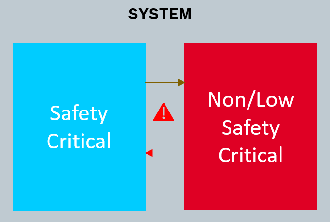

# Freedom from Interference Introduction {#freedom-from-interference-introduction .p_Heading1 style="page-break-after: avoid;"}

+:----------------------------------------------------------------------------------------------------------------------------------------------------------------------------------------------------------------------------------+----------------------------------------------------------------------------------------------------------------------------------------------------------------------+
| **Navigation:**  [Safety manual](safety-manual.html) \> [Safety-related software and software toolchain](safety-relatedsoftwareandsoftwaretoolchain.html) \> [Freedom from Interference (FFI)](freedom-from-interference.html) \> |    |
|                                                                                                                                                                                                                                   |                                                                                                                                                                      |
| # Freedom from Interference Introduction {#freedom-from-interference-introduction-1 .p_Heading1 style="page-break-after: avoid;"}                                                                                                 |                                                                                                                                                                      |
+-----------------------------------------------------------------------------------------------------------------------------------------------------------------------------------------------------------------------------------+----------------------------------------------------------------------------------------------------------------------------------------------------------------------+

## Definition {#definition .p_Heading2 style="page-break-after: avoid;"}

Freedom from Interference is a concept that is used to enable the coexistence of subsystems of different safety levels within one system. Such subsystems are independent, which means a fault in a non-safety subsystem does not interfere with the functionality of the safety-related one. E.g., in a system, a fault in non- or lesser safety-critical subsystem shall not interfere with the functionality of higher safety subsystem. In the RC4x system, ASW can consist of software components with different safety levels. Usage of freedom from interference concept in the BSW can ensure different software components in the ASW to be free from any interference.

<figure style="margin:0;padding:0">

<figcaption aria-hidden="true">
Figure 134: Schematic of freedom from interference concept.
</figcaption>
</figure>

In general freedom from interference concept is expected to address below mentioned undesired functionality in a mixed critical system/software which can result in hazardous incidents. It could be related to memory, timing/execution, and exchange of information. Examples of such undesired functionality which can result in hazardous incidents:

1\. Corruption of contents in memory

2\. Memory access-related faults

3\. Blocking of the execution time of tasks/interrupts

4\. Deadlocks

5\. Incorrect synchronizations

6\. Loss and delay of information

7\. Incorrect sequence, etc.

## Typical scenarios to realize FFI concept {#typical-scenarios-to-realize-ffi-concept .p_Heading2 style="page-break-after: avoid;"}

Below are the different scenarios foreseen in safety-critical application software

1\. Hosting a legacy QM software with SRL software in one ECU

2\. Hosting software components (same/different safety levels) from different vendors in one ECU

3\. Hosting software components with different safety levels in an ECU. The best example for this could be when the functionality of two ECUs (where one ECU is handling a safety-critical application and another ECU is handling non-safety/lesser safety-critical application) needs to be merged and implemented in one ECU

 

RC4x use case can typically look like below:

1\. Integration of legacy software (possibly from the old RC30 platform) with lower/non-safety level into ASW in the RC4x platform.

2\. Integration of third-party software with lower/non-safety level into ASW in the RC4x platform.

3\. Start a new project that involves two types of software one with the highest safety level and the other with a lower/non-safety level.
