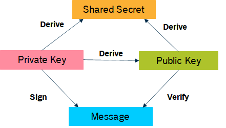
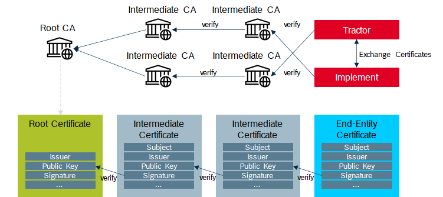
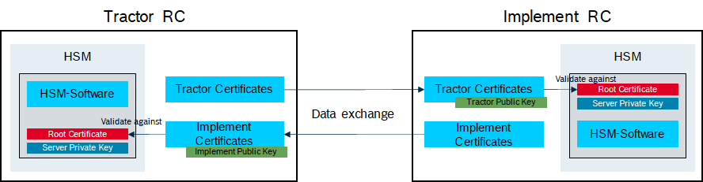

# X.509 certificates {#x.509-certificates .p_Heading1 style="page-break-after: avoid;"}

+:-----------------------------------------------------------------------------------------------------------------------------------------------------------------------------------------------------------------------+--------------------------------------------------------------------------------------------------------------------------------------------+
| **Navigation:**  [System features](system-concepts.html) \> [Security](security.html) \> [Security components](security-components.html) \> [Tractor Implement Management (TIM)](tractor-implement-management.html) \> |    |
|                                                                                                                                                                                                                        |                                                                                                                                            |
| # X.509 certificates {#x.509-certificates-1 .p_Heading1 style="page-break-after: avoid;"}                                                                                                                              |                                                                                                                                            |
+------------------------------------------------------------------------------------------------------------------------------------------------------------------------------------------------------------------------+--------------------------------------------------------------------------------------------------------------------------------------------+

This chapter provides a quick overview of digital certificates in respect to the Tractor Implement Management feature.

## Private and Public keys {#private-and-public-keys .p_Heading2 style="page-break-after: avoid;"}

A private key is a confidential peace of information that is, amongst others, used for signing arbitrary blocks of data. The derived public key can be used to verify signed data without having knowledge about the secret private key. If a message is verified with a certain public key, the holder of the public key has proof that 1) the message has originally been issued by a party that is in possession of the respective private key and 2) the message has not been altered since it has been signed.

 

Once both parties have successfully exchanged their public keys and have proof that their received public key originates from a trusted source (see below on how this can be achieved), the private key and the exchanged public key can be used to derive a shared secret. This secret forms the foundation for a secure communication without having to transfer any secret information over the ISOBUS.

 

<figure style="margin:0;padding:0">

<figcaption aria-hidden="true">
Figure15: The most important relations between a public and a private key for Tractor Implement Management.
</figcaption>
</figure>

## Digital certificates {#digital-certificates .p_Heading2 style="page-break-after: avoid;"}

Digital certificates are crucial in a broad area of applications for ensuring the authenticity and integrity of information using cryptographic algorithms. Digital certificates are usually issued by a Certification Authority (CA), which serves as a central root of trust between two or more involved parties. The root of trust is resembled by a root certificate that the respective CA derived originally, using it\'s private key.

 

<figure style="margin:0;padding:0">

<figcaption aria-hidden="true">
Figure16: Tractor and Implement can verify exchanged certificates against an already trusted root certificate to form a trust basis with each other.
</figcaption>
</figure>

Derived certificates that have been issued by a CA can be verified against the root certificate of the CA, which is usually publicly available and known. By verifying a certificate against a trusted certificate, a third party can make sure that the given certificate has originally been issued by the owner of the already trusted certificate.

 

For RC4x devices, a copy of the AEF root certificate is stored in the [Hardware Security Module (HSM)](hardware-security-module.html){.topiclink} by default. Exchanged certificates are validated against the stored root certificate to check the origin of the contained tractor or implement public key. For more details of the process, please refer to the TIM Full-Weight Authentication (FwA) process in the AEF guidelines.

<figure style="margin:0;padding:0">

<figcaption aria-hidden="true">
Figure17: Storing the root certificate in a protected area provides a root-of-trust for each device. Certificates can be validated transitively against the stored, trusted root certificate (chain validation).
</figcaption>
</figure>

 
