# XCP on CAN usage with CANape {#xcp-on-can-usage-with-canape .p_Heading1 style="page-break-after: avoid;"}

+:-------------------------------------------------------------------------------------------------------------------------+----------------------------------------------------------------------------------------------+
| **Navigation:**  [How-Tos](how-to.html) \> [XCP usage with tools](xcp-usage-with-tools.html) \> [CANape](canape.html) \> |    |
|                                                                                                                          |                                                                                              |
| # XCP on CAN usage with CANape {#xcp-on-can-usage-with-canape-1 .p_Heading1 style="page-break-after: avoid;"}            |                                                                                              |
+--------------------------------------------------------------------------------------------------------------------------+----------------------------------------------------------------------------------------------+

This page provides a step-by-step procedure for using the CANape tool with Vector HW (e.g., VN5610A) as a master for performing measurement and calibration by importing an A2L file using CAN as the transport layer.

Used tool version: V16.0 SP3.

 

1\. Devices -\> Device Configuration.

   

  [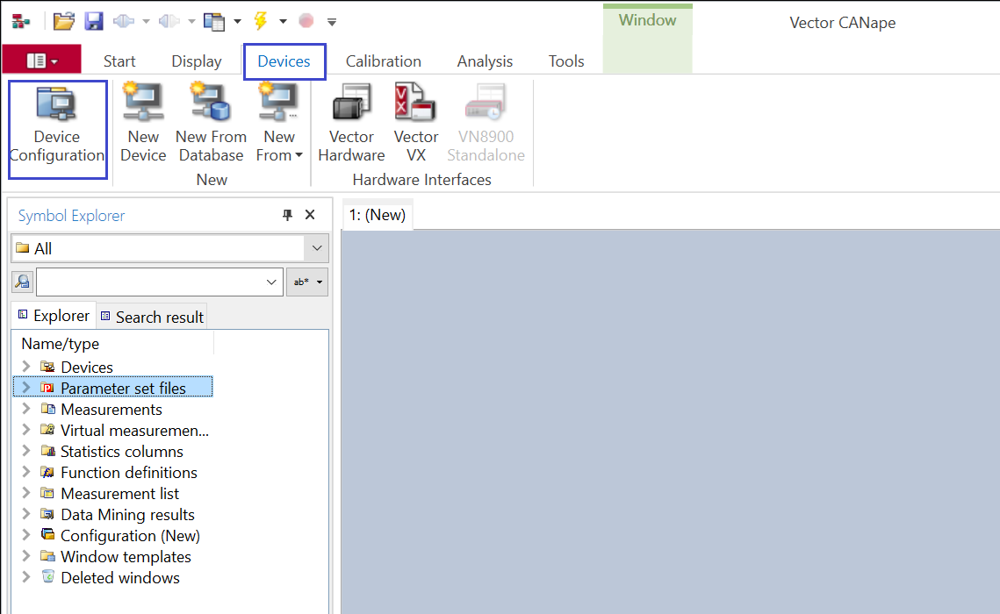{#toggle0186a1 .image-toggle style="width:3.6250in;height:2.2292in;border:none"}{.image-toggle-magnifier}](c1.png){.imagetogglelink style="margin:0;width:3.6250in;height:2.2292in"}

   

2\. Right Click on Networks -\> Select Create new CAN network.

 

  [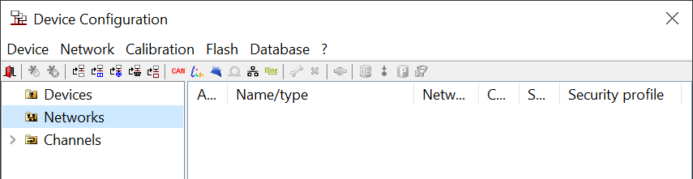{#toggle0186a2 .image-toggle style="width:3.6667in;height:0.9479in;border:none"}{.image-toggle-magnifier}](c2_edited.png){.imagetogglelink style="margin:0;width:3.6667in;height:0.9479in"}   [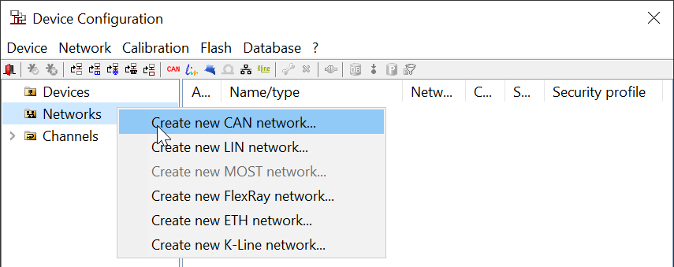{#toggle0186a3 .image-toggle style="width:3.6667in;height:1.4583in;border:none"}{.image-toggle-magnifier}](c3_edited.png){.imagetogglelink style="margin:0;width:3.6667in;height:1.4583in"}

 

3\. Enter name of network. Set baudrate of 1000 KBaud.

   

[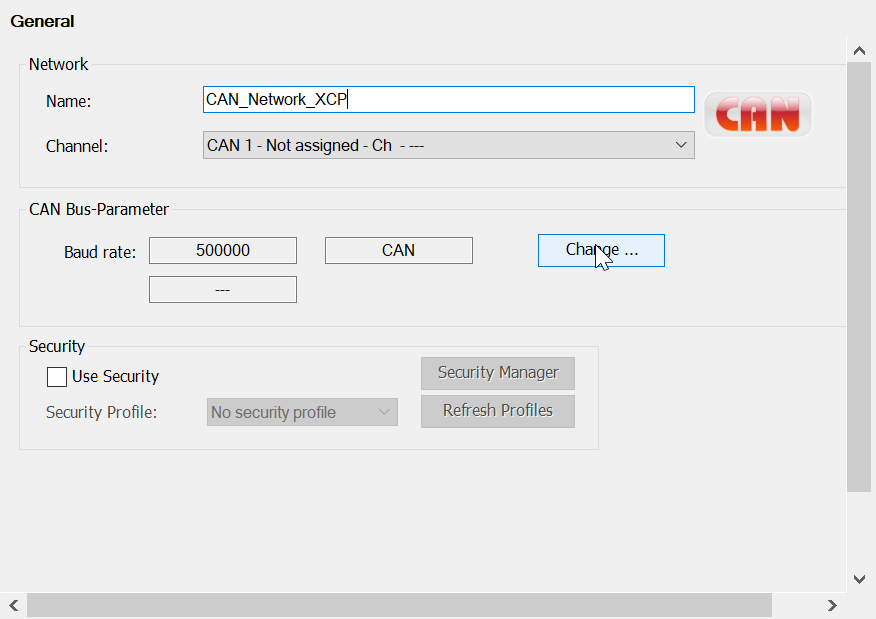{#toggle0186a4 .image-toggle style="width:3.2917in;height:2.3229in;border:none"}{.image-toggle-magnifier}](c4.png){.imagetogglelink style="margin:0;width:3.2917in;height:2.3229in"} [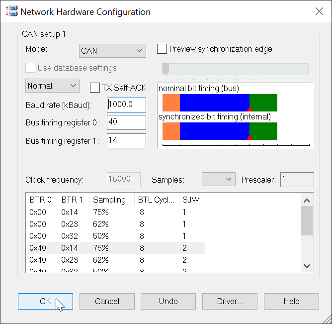{#toggle0186a5 .image-toggle style="width:2.3750in;height:2.3229in;border:none"}{.image-toggle-magnifier}](c5.png){.imagetogglelink style="margin:0;width:2.3750in;height:2.3229in"} [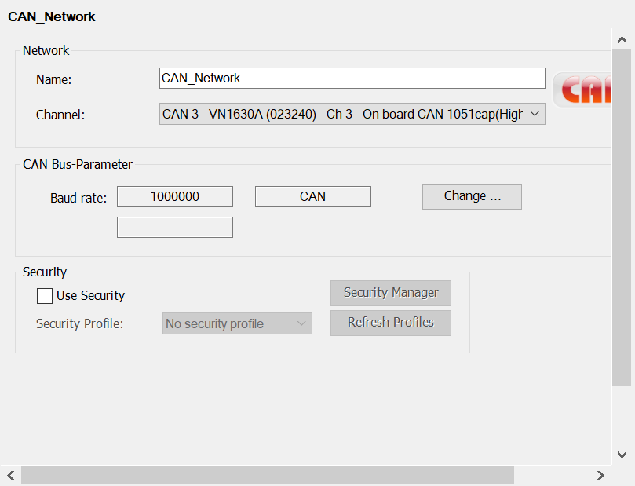{#toggle0186a6 .image-toggle style="width:3.0000in;height:2.3021in;border:none"}{.image-toggle-magnifier}](c6.png){.imagetogglelink style="margin:0;width:3.0000in;height:2.3021in"}

 

4\. Close the window.

 

  [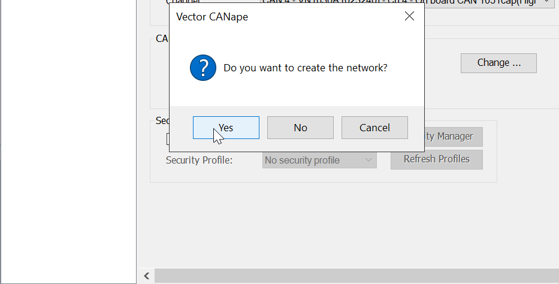{#toggle0186a7 .image-toggle style="width:3.6979in;height:1.8854in;border:none"}{.image-toggle-magnifier}](c7.png){.imagetogglelink style="margin:0;width:3.6979in;height:1.8854in"}

 

5\. Right-click on devices -\> Select New.

 

  [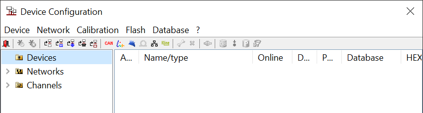{#toggle0186a8 .image-toggle style="width:3.7083in;height:0.9896in;border:none"}{.image-toggle-magnifier}](c8_edited.png){.imagetogglelink style="margin:0;width:3.7083in;height:0.9896in"}     [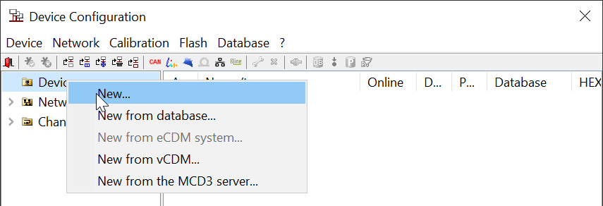{#toggle0186a9 .image-toggle style="width:3.7083in;height:1.2708in;border:none"}{.image-toggle-magnifier}](c9_edited.png){.imagetogglelink style="margin:0;width:3.7083in;height:1.2708in"}

 

6\. Enter Name. Select XCP. Press the \"Next\" button at the bottom.

   

  [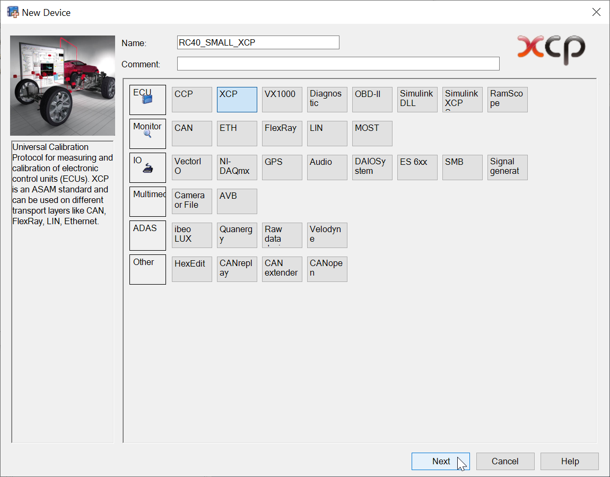{#toggle0186aa .image-toggle style="width:3.7188in;height:2.9063in;border:none"}{.image-toggle-magnifier}](c10.png){.imagetogglelink style="margin:0;width:3.7188in;height:2.9063in"}

 

7\. If data sets are used, then select \"Activate dataset management\" -\> Browse a dataset directory in \"Select a dataset directory\". Press \"Next\".

   If data sets are not used, Press \"Next\".

   

  [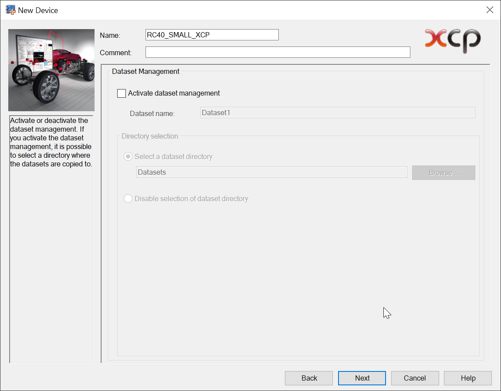{#toggle0186ab .image-toggle style="width:3.6667in;height:2.8646in;border:none"}{.image-toggle-magnifier}](c11.png){.imagetogglelink style="margin:0;width:3.6667in;height:2.8646in"}

 

8\. Browse the Database name: a2l file of generated BSW package from easyConfig. Press \"Next\".

 

  [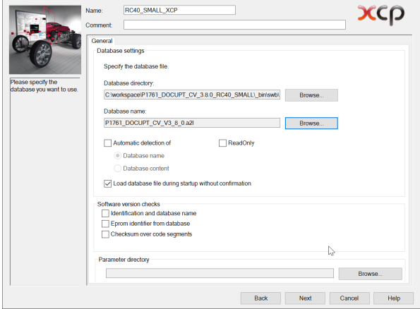{#toggle0186ac .image-toggle style="width:3.6563in;height:2.6875in;border:none"}{.image-toggle-magnifier}](c12.png){.imagetogglelink style="margin:0;width:3.6563in;height:2.6875in"}

 

9\. Select \"CAN\" in \"Transport Layer Type\". Select \"CAN Network\" in \"Networks\". Press \"Next\".

 

  [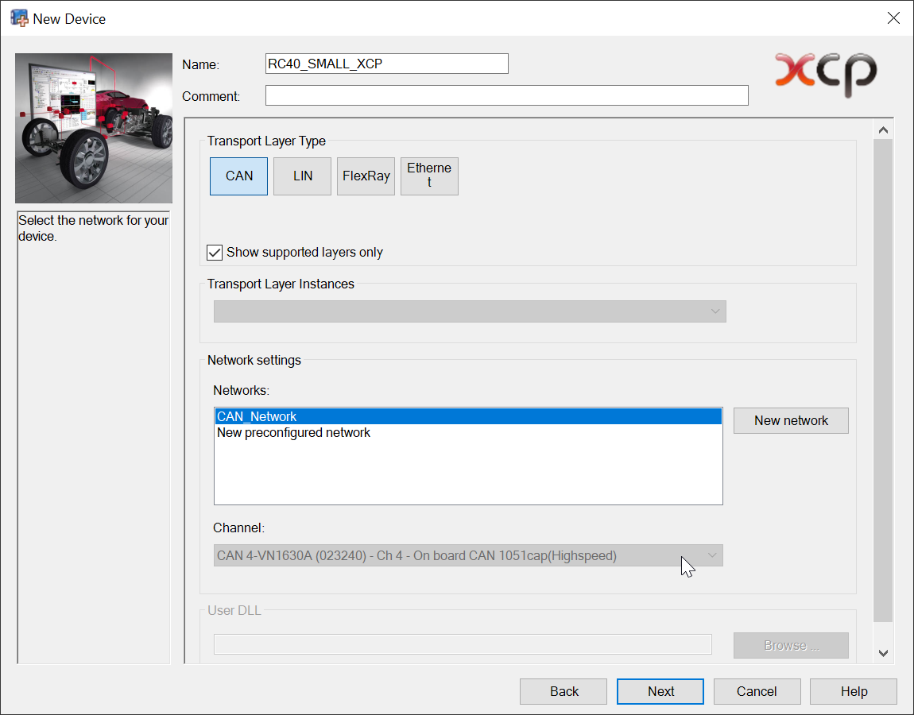{#toggle0186ad .image-toggle style="width:3.6458in;height:2.8542in;border:none"}{.image-toggle-magnifier}](c13.png){.imagetogglelink style="margin:0;width:3.6458in;height:2.8542in"}

 

10\. Select options as shown in figure. Press \"New\".

 

    [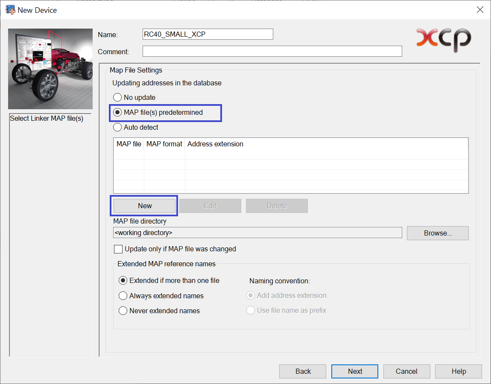{#toggle0186ae .image-toggle style="width:3.5729in;height:2.8021in;border:none"}{.image-toggle-magnifier}](c14.png){.imagetogglelink style="margin:0;width:3.5729in;height:2.8021in"}

 

11\. Enter name of elf file which was generated after ASW build. Select Format of the MAP file: ELF/DWARF 32/64 Bit. Press button "OK".

 

    [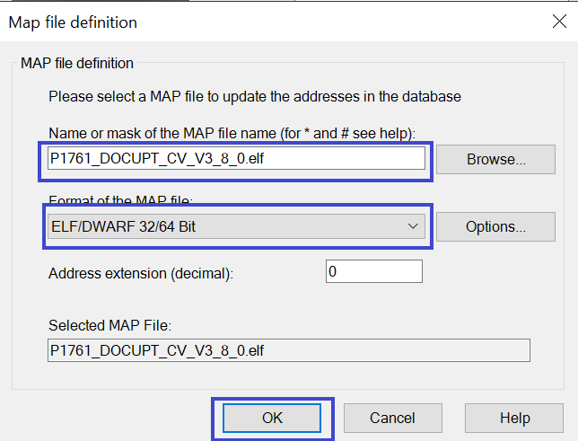{#toggle0186af .image-toggle style="width:2.0208in;height:1.5417in;border:none"}{.image-toggle-magnifier}](c15_edited.png){.imagetogglelink style="margin:0;width:2.0208in;height:1.5417in"}

 

12\. Press \"Next\".

     

    [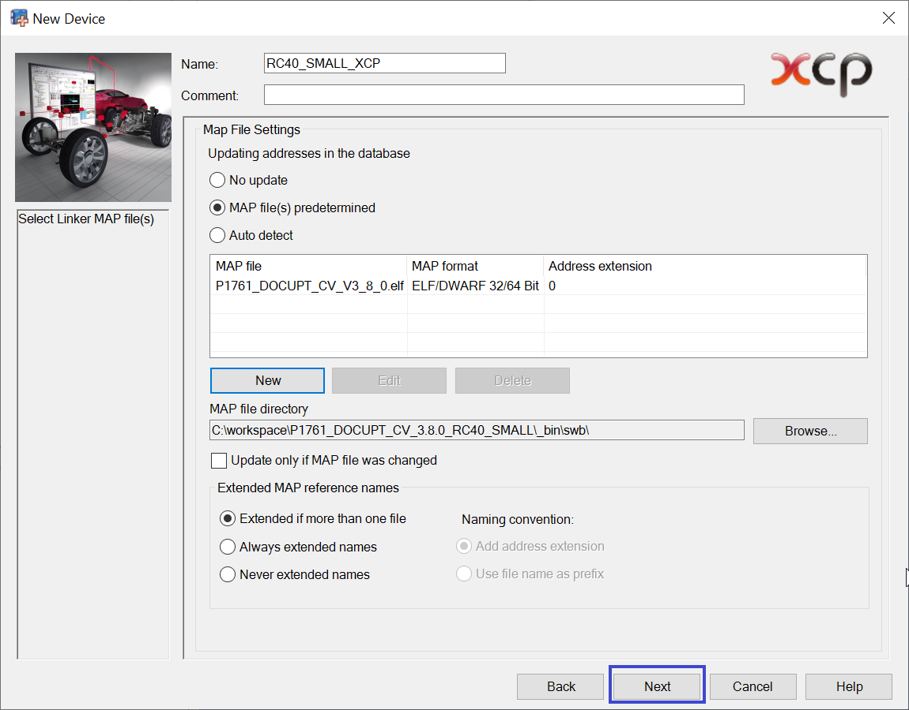{#toggle0186b0 .image-toggle style="width:3.6875in;height:2.8854in;border:none"}{.image-toggle-magnifier}](c16.png){.imagetogglelink style="margin:0;width:3.6875in;height:2.8854in"}

 

13\. Enter/browse "Memory image file name:" ASW-hex file. Press button "OK".

   

    [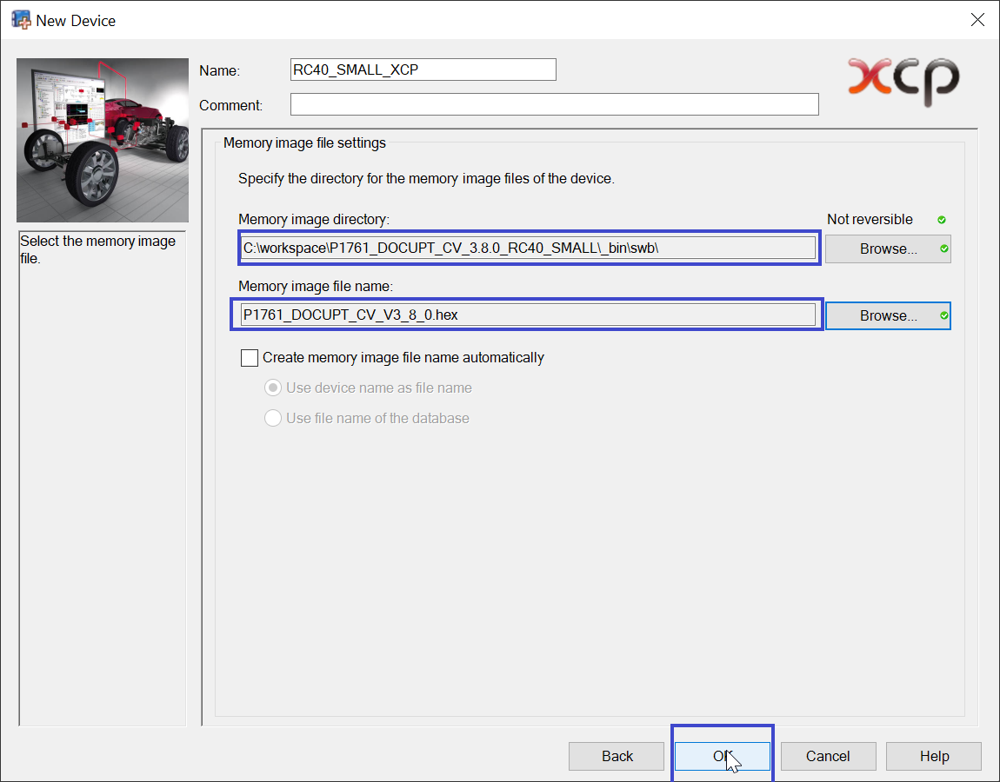{#toggle0186b1 .image-toggle style="width:3.7188in;height:2.9167in;border:none"}{.image-toggle-magnifier}](c17.png){.imagetogglelink style="margin:0;width:3.7188in;height:2.9167in"}

 

14\. Close window.

     

    [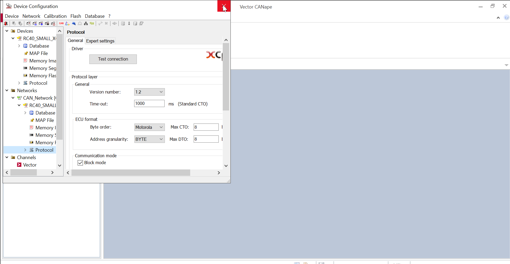{#toggle0186b2 .image-toggle style="width:3.7396in;height:1.9375in;border:none"}{.image-toggle-magnifier}](c18.png){.imagetogglelink style="margin:0;width:3.7396in;height:1.9375in"}

 

15\. In Explorer tab below -\> expand Devices -\> Under the configured device name\[e.g. RC40_SMALL_XCP\], right click on the selected database -\> Select \"Open database\"    .

   

      [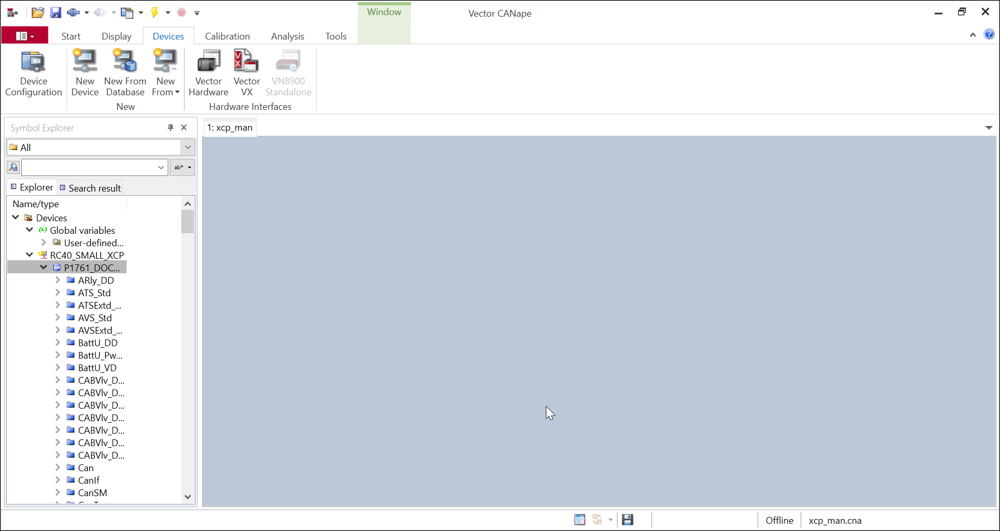{#toggle0186b3 .image-toggle style="width:3.5729in;height:1.8958in;border:none"}{.image-toggle-magnifier}](c19.png){.imagetogglelink style="margin:0;width:3.5729in;height:1.8958in"}       [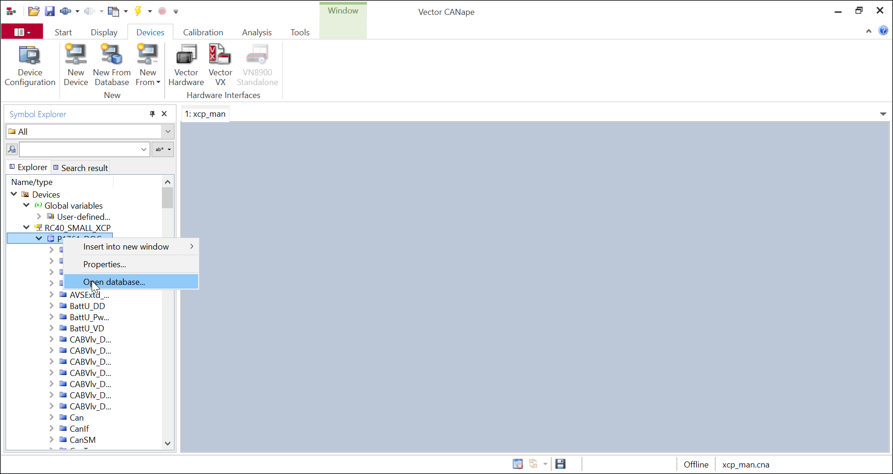{#toggle0186b4 .image-toggle style="width:3.5938in;height:1.9063in;border:none"}{.image-toggle-magnifier}](c20.png){.imagetogglelink style="margin:0;width:3.5938in;height:1.9063in"}

 

16\. Edit -\> New variable from MAP file.

 

    [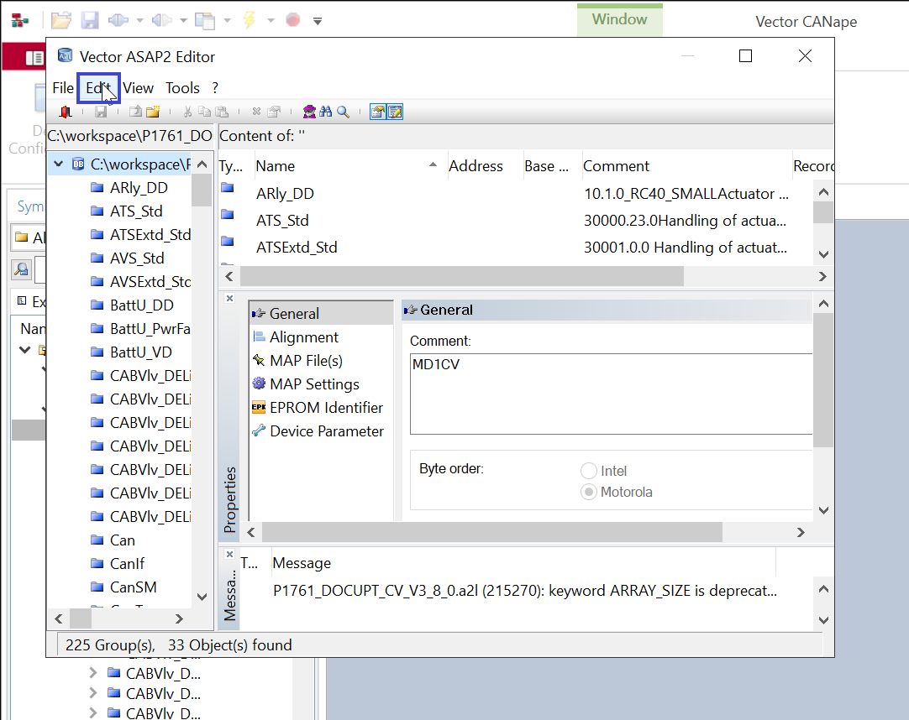{#toggle0186b5 .image-toggle style="width:3.6771in;height:2.9167in;border:none"}{.image-toggle-magnifier}](c21.png){.imagetogglelink style="margin:0;width:3.6771in;height:2.9167in"}       [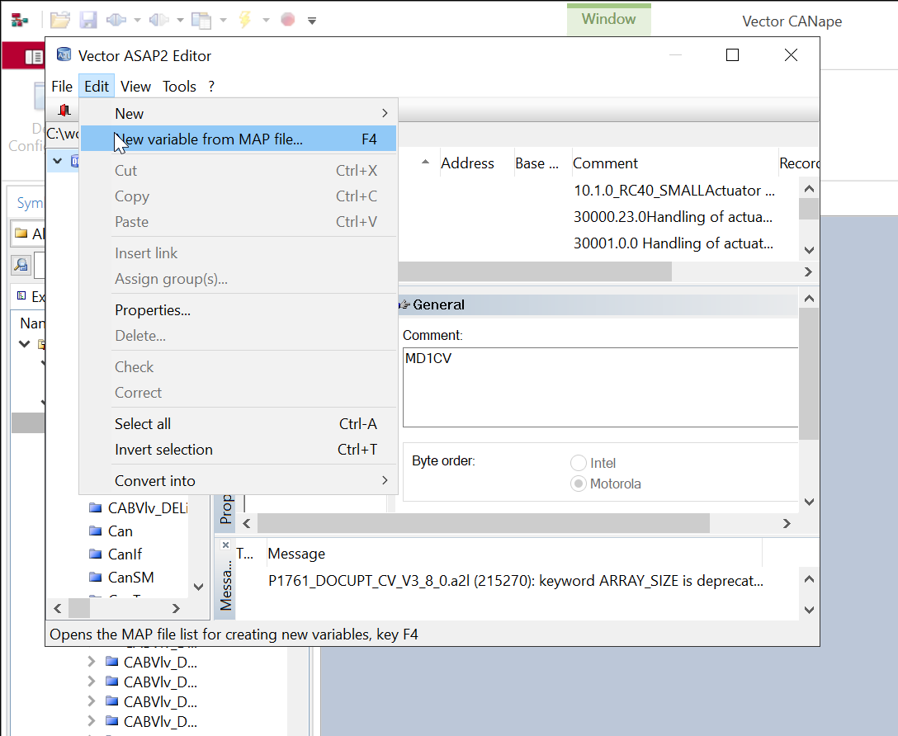{#toggle0186b6 .image-toggle style="width:3.5521in;height:2.9063in;border:none"}{.image-toggle-magnifier}](c22.png){.imagetogglelink style="margin:0;width:3.5521in;height:2.9063in"}

 

17\. Select variable. Click \"OK\" .

     

    [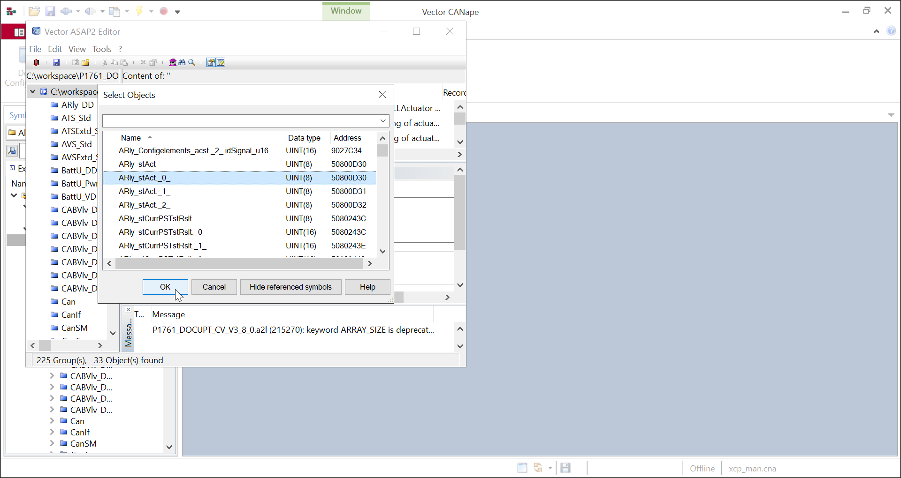{#toggle0186b7 .image-toggle style="width:3.7604in;height:2.0000in;border:none"}{.image-toggle-magnifier}](c23.png){.imagetogglelink style="margin:0;width:3.7604in;height:2.0000in"}

 

18\. Press button "Measurement value" (read only) or "Parameter" (read + write). Repeat it for all variables which shall be observed.

     

    [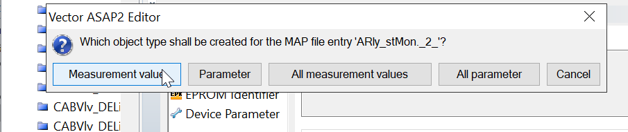{#toggle0186b8 .image-toggle style="width:3.7708in;height:0.7917in;border:none"}{.image-toggle-magnifier}](c24.png){.imagetogglelink style="margin:0;width:3.7708in;height:0.7917in"}

 

19\. File -\> Save. If all variables are added, CLOSE window.

     

    [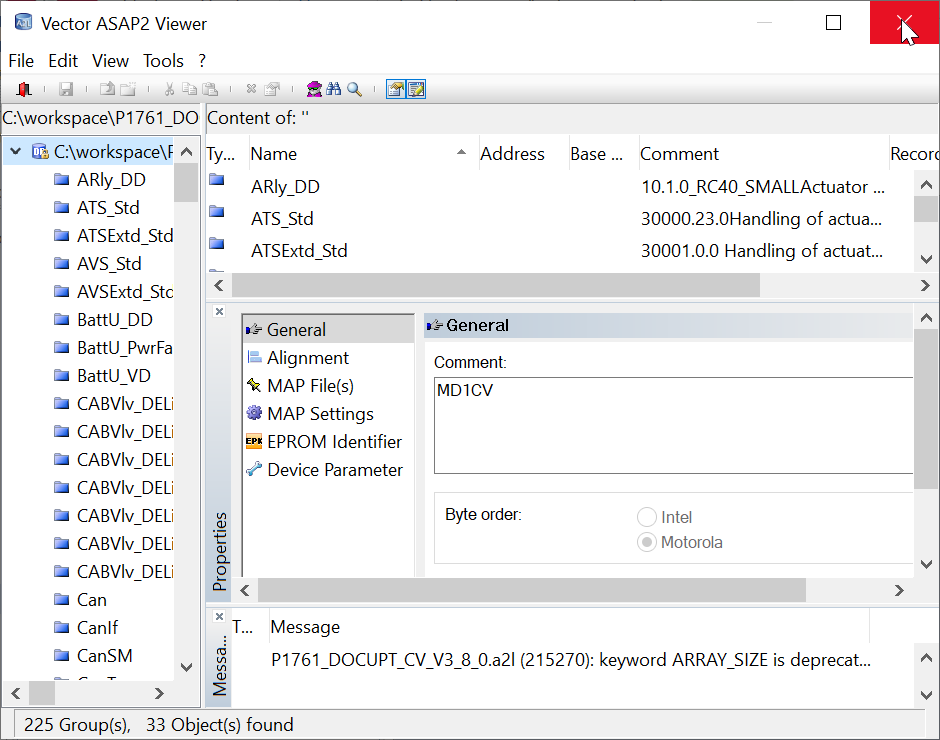{#toggle0186b9 .image-toggle style="width:3.8021in;height:2.9896in;border:none"}{.image-toggle-magnifier}](c25.png){.imagetogglelink style="margin:0;width:3.8021in;height:2.9896in"}

 

20\. Start -\> Measurement Configuration -\> Signals.

 

    [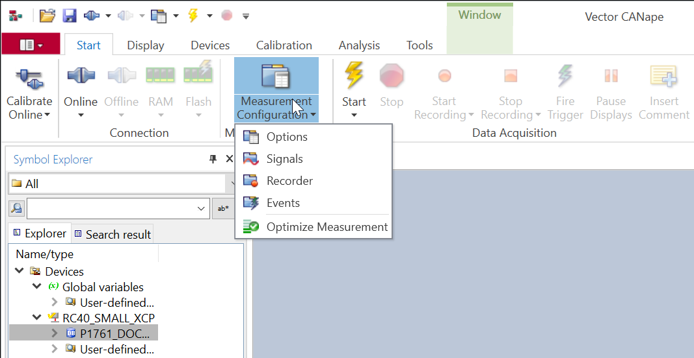{#toggle0186ba .image-toggle style="width:2.1250in;height:1.0938in;border:none"}{.image-toggle-magnifier}](c26_edited.png){.imagetogglelink style="margin:0;width:2.1250in;height:1.0938in"}

 

21\. Edit -\> Insert signal.

 

    [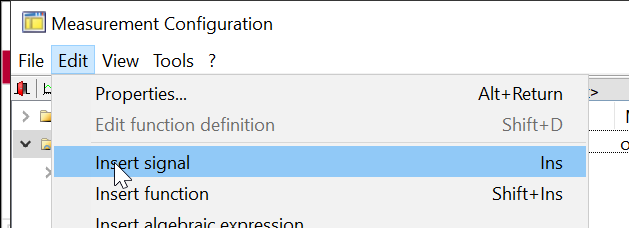{#toggle0186bb .image-toggle style="width:1.9271in;height:0.6979in;border:none"}{.image-toggle-magnifier}](c27_edited.png){.imagetogglelink style="margin:0;width:1.9271in;height:0.6979in"}

 

22\. Select a variable. Close window.

 

    [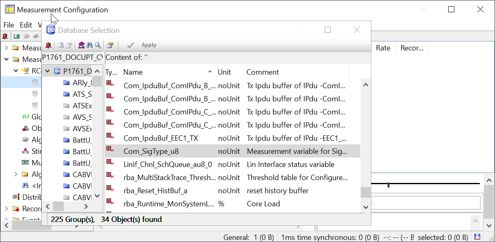{#toggle0186bc .image-toggle style="width:3.8438in;height:1.8750in;border:none"}{.image-toggle-magnifier}](c28.png){.imagetogglelink style="margin:0;width:3.8438in;height:1.8750in"}

 

23\. Display -\> New window -\> Select a window for displaying the signal(variable).

 

    [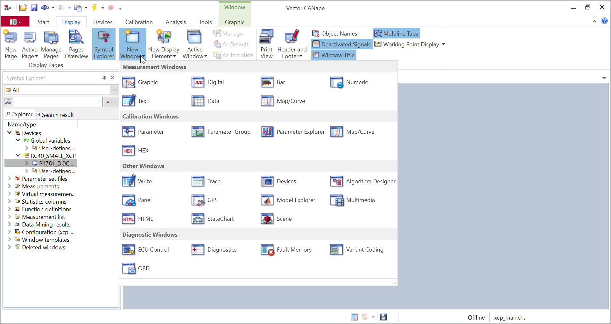{#toggle0186bd .image-toggle style="width:3.8854in;height:2.0625in;border:none"}{.image-toggle-magnifier}](c29.png){.imagetogglelink style="margin:0;width:3.8854in;height:2.0625in"}

 

24\. Right click under \"Name\" on the display window -\> Insert -\>Insert from measurement signal.

 

      [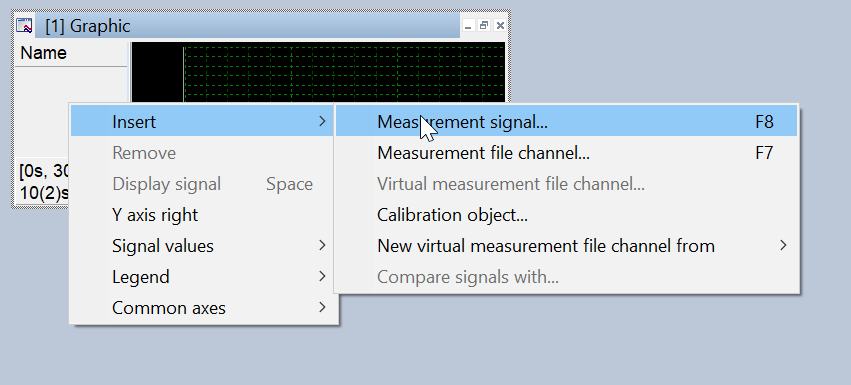{#toggle0186be .image-toggle style="width:3.8646in;height:1.7500in;border:none"}{.image-toggle-magnifier}](c30.png){.imagetogglelink style="margin:0;width:3.8646in;height:1.7500in"}

 

25\. Select a signal.  Close window.

 

    [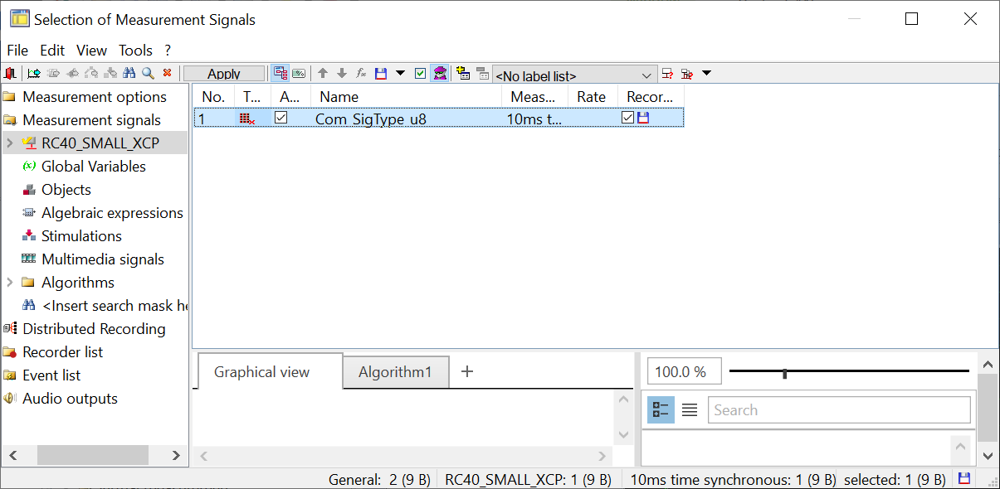{#toggle0186bf .image-toggle style="width:3.9167in;height:1.9167in;border:none"}{.image-toggle-magnifier}](c31.png){.imagetogglelink style="margin:0;width:3.9167in;height:1.9167in"}

 

26\. Result obtained is as shown below.

 

    [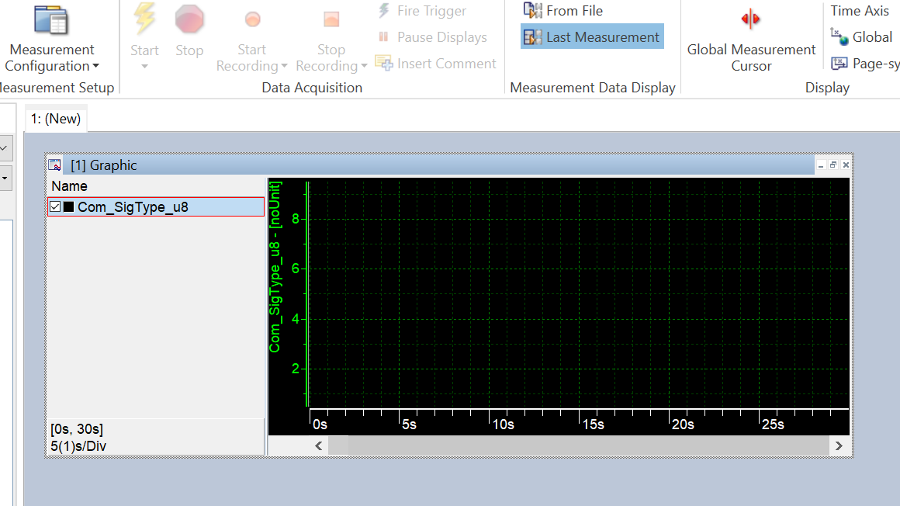{#toggle0186c0 .image-toggle style="width:3.8854in;height:2.1875in;border:none"}{.image-toggle-magnifier}](c32.png){.imagetogglelink style="margin:0;width:3.8854in;height:2.1875in"}

 

27\. Continue with "connect" + "start measurement". Finally save the configuration: File -\> Save configuration.

 

   

 

 

 

 

 

 

 

   

   

   
