# XCP on CAN usage with INCA {#xcp-on-can-usage-with-inca .p_Heading1 style="page-break-after: avoid;"}

+:---------------------------------------------------------------------------------------------------------------------+--------------------------------------------------------------------------------------------------------------------+
| **Navigation:**  [How-Tos](how-to.html) \> [XCP usage with tools](xcp-usage-with-tools.html) \> [INCA](inca.html) \> |    |
|                                                                                                                      |                                                                                                                    |
| # XCP on CAN usage with INCA {#xcp-on-can-usage-with-inca-1 .p_Heading1 style="page-break-after: avoid;"}            |                                                                                                                    |
+----------------------------------------------------------------------------------------------------------------------+--------------------------------------------------------------------------------------------------------------------+

This page provides a step-by-step procedure for using the INCA tool as a master for performing measurement and calibration by importing an A2L file using CAN as the transport layer.

Used tool version: V7.2.

Prerequisite: ECU flashed and running.

1\. Open INCA.

2\. Menu -\> Database -\> New.

 

  [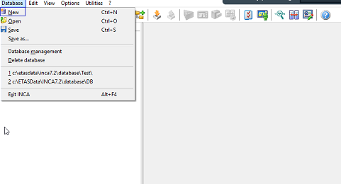{#toggle0186a1 .image-toggle style="width:3.7396in;height:2.0208in;border:none"}{.image-toggle-magnifier}](i1.png){.imagetogglelink style="margin:0;width:3.7396in;height:2.0208in"}

 

 

3\. Enter database name -\> Right click on \"Default\" under \"Database objects\" -\> Click on \"Add\" -\> Select \"Workspace\"\[Ctrl+W\].

 

  [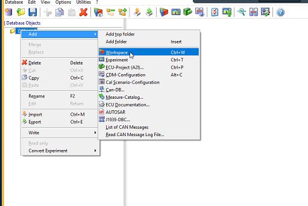{#toggle0186a2 .image-toggle style="width:3.6875in;height:2.4688in;border:none"}{.image-toggle-magnifier}](i4.png){.imagetogglelink style="margin:0;width:3.6875in;height:2.4688in"}

 

4\. Enter workspace name -\> Click \"OK\". The workspace is created \[e.g., Example_ws\].

 

  [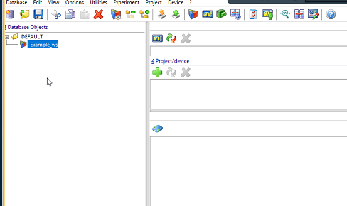{#toggle0186a3 .image-toggle style="width:3.7604in;height:2.2396in;border:none"}{.image-toggle-magnifier}](i5.png){.imagetogglelink style="margin:0;width:3.7604in;height:2.2396in"}

 

5\. Right click on the workspace created \[e.g., Example_ws\] -\> Click on \"Add\" -\> Select \"Experiment\" \[Ctrl+T\].

 

  [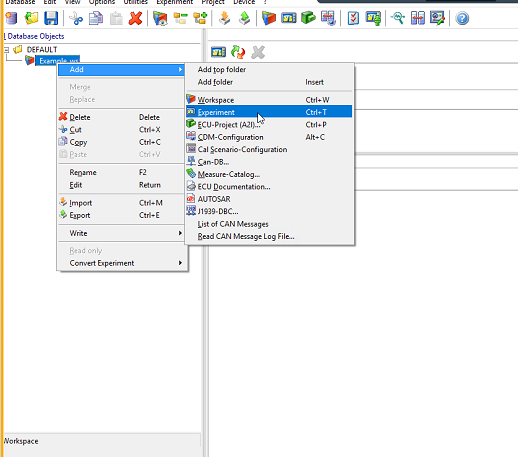{#toggle0186a4 .image-toggle style="width:3.8229in;height:3.3750in;border:none"}{.image-toggle-magnifier}](i6.png){.imagetogglelink style="margin:0;width:3.8229in;height:3.3750in"}

 

6\. Enter experiment name -\> Click \"OK\". The experiment is created.

 

  [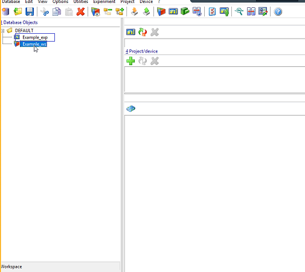{#toggle0186a5 .image-toggle style="width:3.7292in;height:3.3333in;border:none"}{.image-toggle-magnifier}](i7.png){.imagetogglelink style="margin:0;width:3.7292in;height:3.3333in"}  

 

7\. Right click on the workspace created \[e.g., Example_ws\] -\> Click on \"Add\" -\> Select \"ECU Project(A2L)\" \[ Ctrl+P \].

 

  [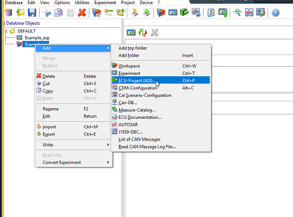{#toggle0186a6 .image-toggle style="width:3.7813in;height:2.8021in;border:none"}{.image-toggle-magnifier}](i8.png){.imagetogglelink style="margin:0;width:3.7813in;height:2.8021in"}

 

8\. Browse to select a2l file -\> Click \"OPEN\" -\> a window for selecting the hex file will open. Since we have already flashed the hex file close the window.  a2l file is added.

   

  [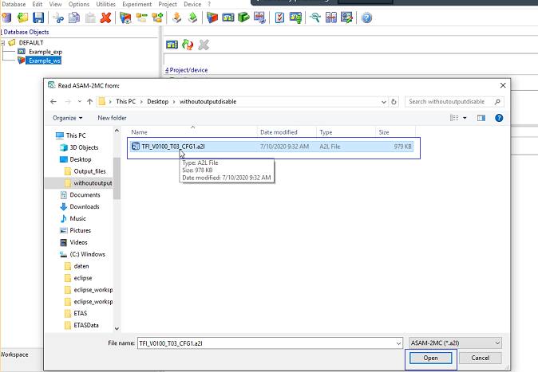{#toggle0186a7 .image-toggle style="width:3.8333in;height:2.6563in;border:none"}{.image-toggle-magnifier}](i9.png){.imagetogglelink style="margin:0;width:3.8333in;height:2.6563in"} [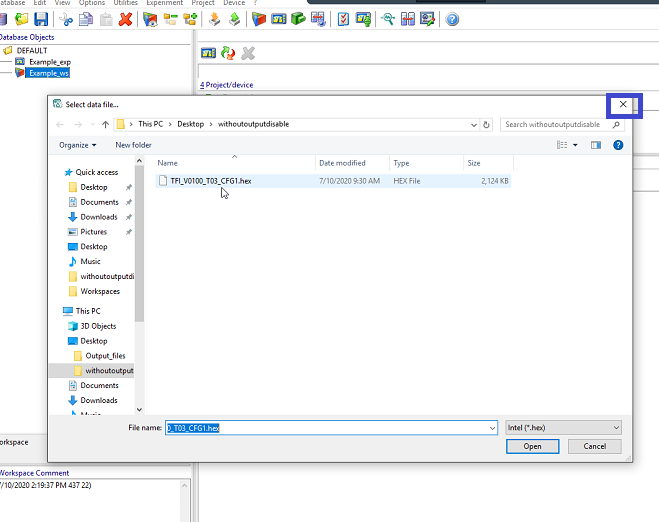{#toggle0186a8 .image-toggle style="width:2.6354in;height:2.0938in;border:none"}{.image-toggle-magnifier}](i10.png){.imagetogglelink style="margin:0;width:2.6354in;height:2.0938in"} [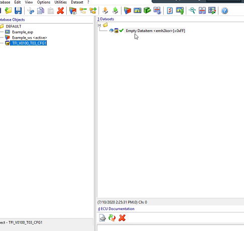{#toggle0186a9 .image-toggle style="width:2.2188in;height:2.1042in;border:none"}{.image-toggle-magnifier}](i11.png){.imagetogglelink style="margin:0;width:2.2188in;height:2.1042in"}

 

9\. Click on the \"Hardware Configuration\" icon.

     

    [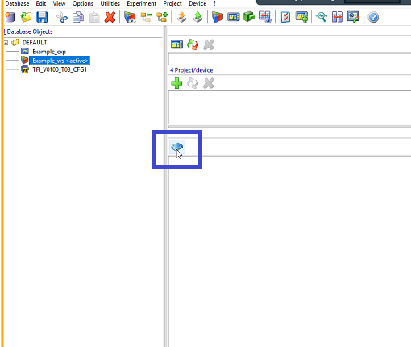{#toggle0186aa .image-toggle style="width:3.7396in;height:3.1563in;border:none"}{.image-toggle-magnifier}](i12.png){.imagetogglelink style="margin:0;width:3.7396in;height:3.1563in"}

 

10\. The Hardware devices window opens -\> Click on the search icon -\> In the drop down list, click \"OK\".

 

      [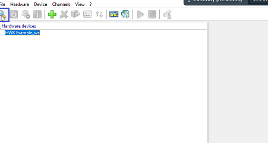{#toggle0186ab .image-toggle style="width:3.7188in;height:1.9896in;border:none"}{.image-toggle-magnifier}](i13.png){.imagetogglelink style="margin:0;width:3.7188in;height:1.9896in"}   [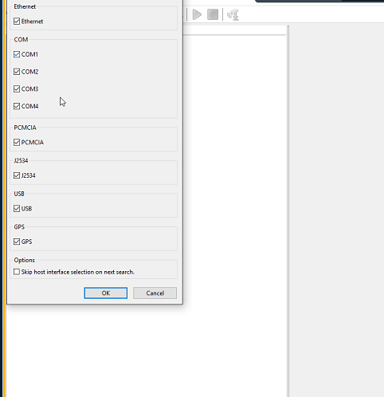{#toggle0186ac .image-toggle style="width:1.9583in;height:2.0208in;border:none"}{.image-toggle-magnifier}](i14.png){.imagetogglelink style="margin:0;width:1.9583in;height:2.0208in"}  

 

11\. If the message \"No connected hardware found\" is received -\> click \"OK\"  -\> Click on the \"Add\" icon -\> Select the hardware device -\> Click on \"OK\".

 

    [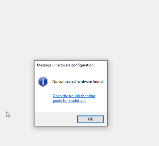{#toggle0186ad .image-toggle style="width:2.8854in;height:2.6458in;border:none"}{.image-toggle-magnifier}](i15.png){.imagetogglelink style="margin:0;width:2.8854in;height:2.6458in"} [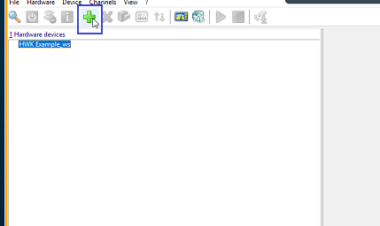{#toggle0186ae .image-toggle style="width:2.6146in;height:1.5625in;border:none"}{.image-toggle-magnifier}](i16.png){.imagetogglelink style="margin:0;width:2.6146in;height:1.5625in"}   [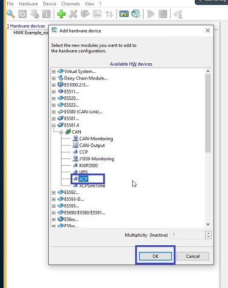{#toggle0186af .image-toggle style="width:2.1458in;height:2.7083in;border:none"}{.image-toggle-magnifier}](i17.png){.imagetogglelink style="margin:0;width:2.1458in;height:2.7083in"}

 

12\. The \"Select project and working data for XCP\" window opens -\> Select the project -\> click \"OK\".

 

    [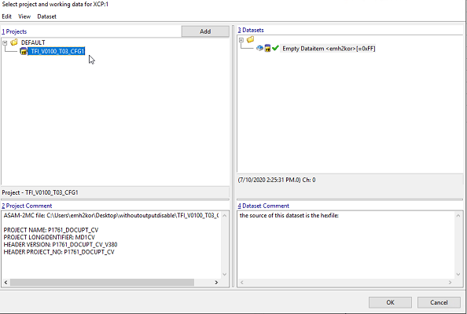{#toggle0186b0 .image-toggle style="width:1.6979in;height:1.1458in;border:none"}{.image-toggle-magnifier}](i18_edited.png){.imagetogglelink style="margin:0;width:1.6979in;height:1.1458in"}     [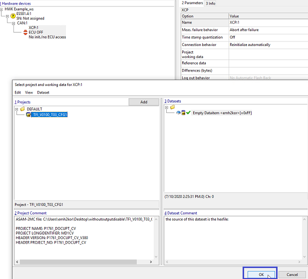{#toggle0186b1 .image-toggle style="width:2.0104in;height:1.8229in;border:none"}{.image-toggle-magnifier}](i19.png){.imagetogglelink style="margin:0;width:2.0104in;height:1.8229in"}

 

13\. The  \"Transport Layer Instance\" window opens -\> Select \"Calibration CAN(APPL)\" -\> Click \"OK\".

     

    [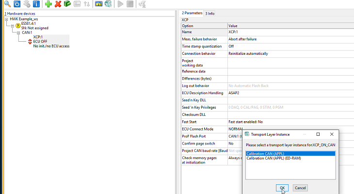{#toggle0186b2 .image-toggle style="width:2.9688in;height:1.6250in;border:none"}{.image-toggle-magnifier}](i20.png){.imagetogglelink style="margin:0;width:2.9688in;height:1.6250in"}

     

 

14\. Under XCP, some options are configurable(e.g., Meas. failure behavior, Connection behavior, Check memory pages at initialization) -\> Select the suitable option.

[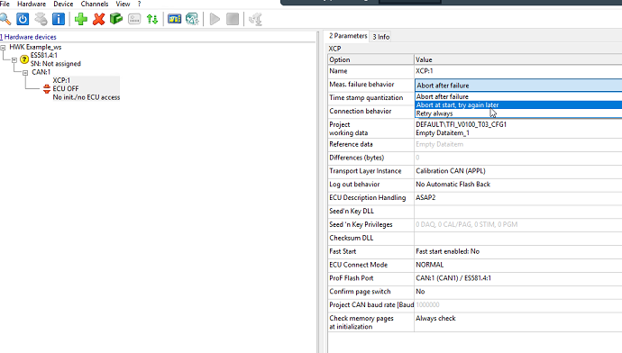{#toggle0186b3 .image-toggle style="width:3.7500in;height:2.1354in;border:none"}{.image-toggle-magnifier}](i21.png){.imagetogglelink style="margin:0;width:3.7500in;height:2.1354in"}   [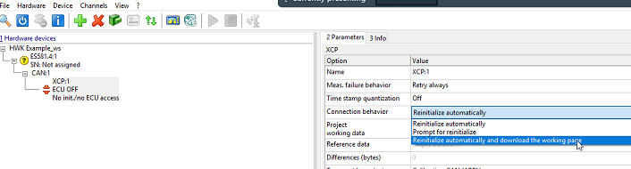{#toggle0186b4 .image-toggle style="width:2.1875in;height:0.5938in;border:none"}{.image-toggle-magnifier}](i22_edited.png){.imagetogglelink style="margin:0;width:2.1875in;height:0.5938in"}   [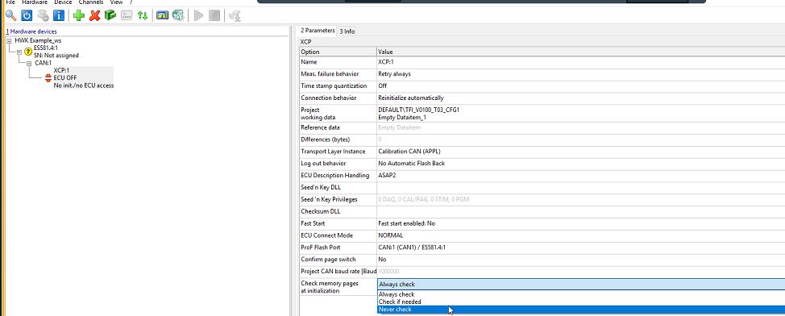{#toggle0186b5 .image-toggle style="width:3.0313in;height:1.2188in;border:none"}{.image-toggle-magnifier}](i23_edited.png){.imagetogglelink style="margin:0;width:3.0313in;height:1.2188in"}

 

15\. Click \"Apply\".

 

    [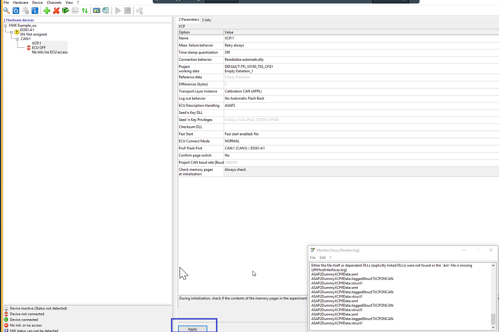{#toggle0186b6 .image-toggle style="width:3.7708in;height:2.5104in;border:none"}{.image-toggle-magnifier}](i24.png){.imagetogglelink style="margin:0;width:3.7708in;height:2.5104in"}

 

16\. Click on \"Initialize Hardware\" icon.

 

    [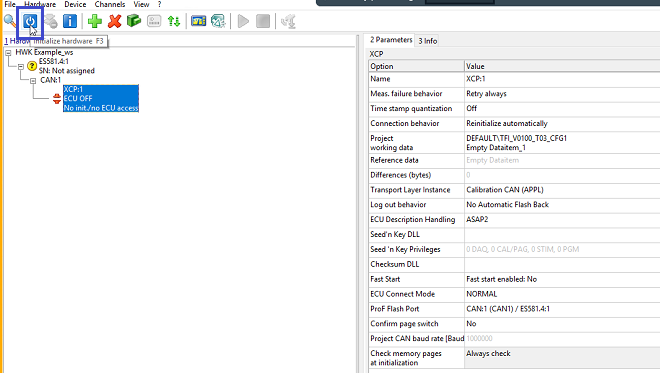{#toggle0186b7 .image-toggle style="width:3.7396in;height:2.1146in;border:none"}{.image-toggle-magnifier}](i25.png){.imagetogglelink style="margin:0;width:3.7396in;height:2.1146in"}

 

17\. The \"Connect Devices\" window opens -\> Click \"OK\" -\> ECU access is turned ON.

 

      [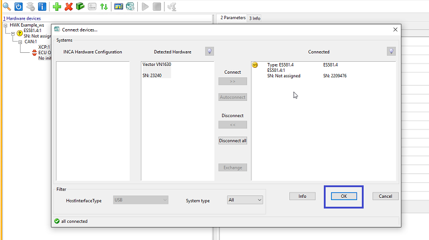{#toggle0186b8 .image-toggle style="width:3.7292in;height:2.0833in;border:none"}{.image-toggle-magnifier}](i26.png){.imagetogglelink style="margin:0;width:3.7292in;height:2.0833in"}       [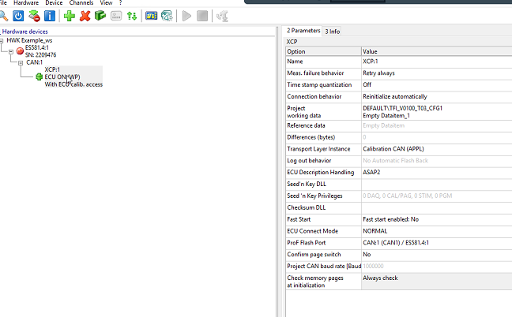{#toggle0186b9 .image-toggle style="width:3.3958in;height:2.1042in;border:none"}{.image-toggle-magnifier}](i27.png){.imagetogglelink style="margin:0;width:3.3958in;height:2.1042in"}

 

18\. The \"memory pages\" window opens -\> Select \"working page\" and click on \"Do it\" -\> This opens a new working page for measuring variables. The \"Confirm - Hardware configuration\" dialog box appears -\> Click on \"YES\".

       

      [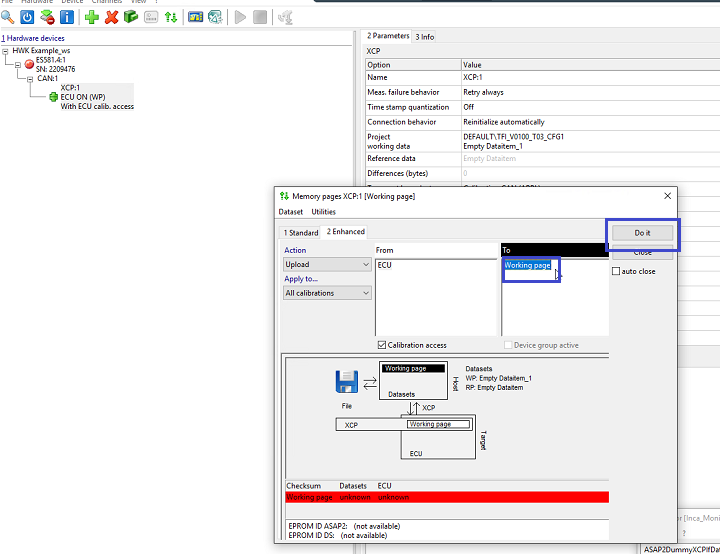{#toggle0186ba .image-toggle style="width:3.7604in;height:2.8958in;border:none"}{.image-toggle-magnifier}](i28.png){.imagetogglelink style="margin:0;width:3.7604in;height:2.8958in"}     [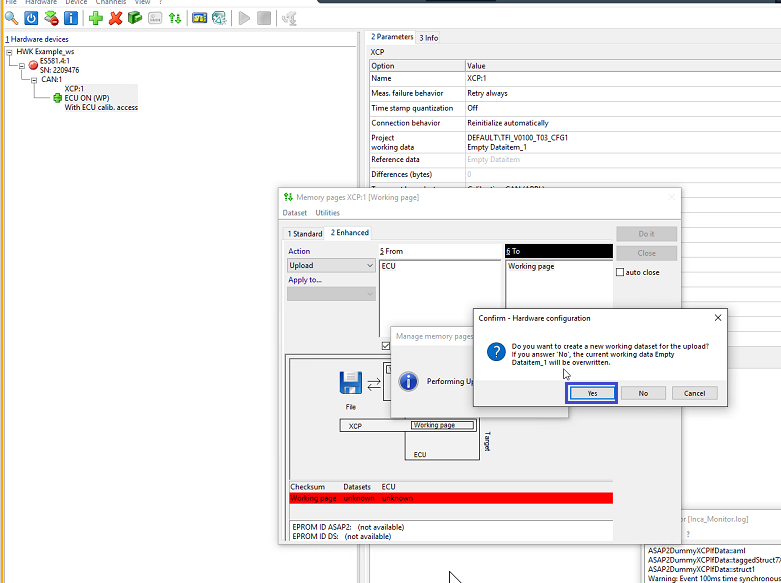{#toggle0186bb .image-toggle style="width:3.8958in;height:2.9063in;border:none"}{.image-toggle-magnifier}](i29.png){.imagetogglelink style="margin:0;width:3.8958in;height:2.9063in"}

             

 

19\. Write a name for the new working data -\> Click \"OK\".

 

    [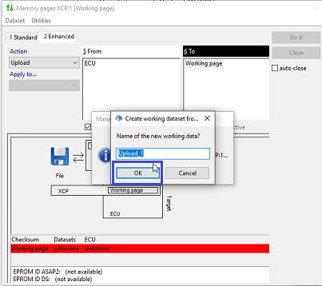{#toggle0186bc .image-toggle style="width:2.2188in;height:1.9688in;border:none"}{.image-toggle-magnifier}](i30_edited.png){.imagetogglelink style="margin:0;width:2.2188in;height:1.9688in"}

 

20\. Click on the \"Experiment Environment\" icon.

 

    [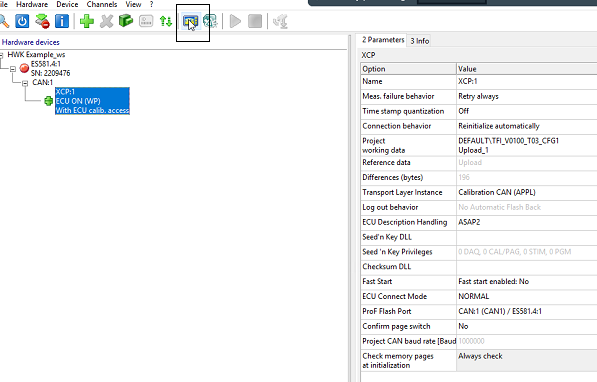{#toggle0186bd .image-toggle style="width:3.9375in;height:2.5208in;border:none"}{.image-toggle-magnifier}](i31.png){.imagetogglelink style="margin:0;width:3.9375in;height:2.5208in"}

     

21\. Once the working page opens -\> click on \"variable selection\" \[ Shift+F4 \].

 

    [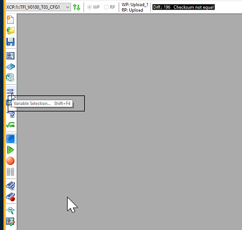{#toggle0186be .image-toggle style="width:3.8750in;height:3.6875in;border:none"}{.image-toggle-magnifier}](i32.png){.imagetogglelink style="margin:0;width:3.8750in;height:3.6875in"}

 

22\. The \"Variable Selection\" window opens -\> Select the variable to be measured or calibrated -\> Click \"OK\".

 

    [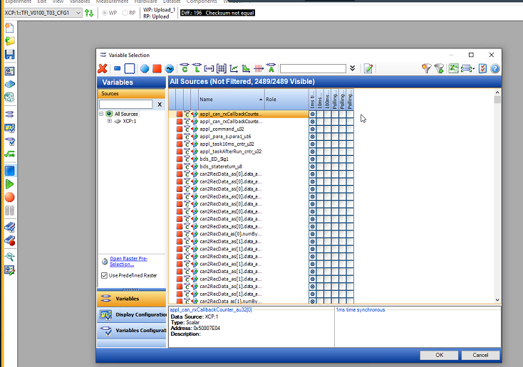{#toggle0186bf .image-toggle style="width:3.9271in;height:2.7604in;border:none"}{.image-toggle-magnifier}](i33.png){.imagetogglelink style="margin:0;width:3.9271in;height:2.7604in"}     [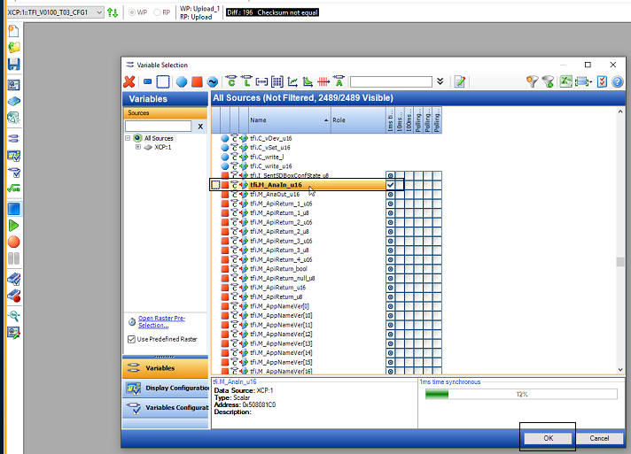{#toggle0186c0 .image-toggle style="width:3.8125in;height:2.7500in;border:none"}{.image-toggle-magnifier}](i34.png){.imagetogglelink style="margin:0;width:3.8125in;height:2.7500in"}

 

23\. A table opens with all the measurement variables selected or a calibration table opens with all the calibration variables selected depending on the type of variables selected. Values of variables can be measured or calibrated.

 

    [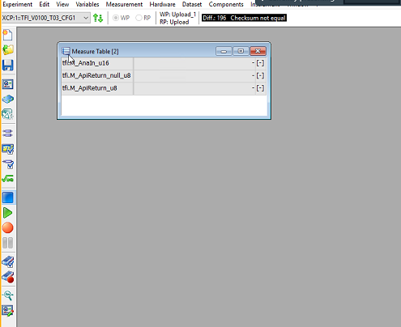{#toggle0186c1 .image-toggle style="width:2.8542in;height:2.3333in;border:none"}{.image-toggle-magnifier}](i36.png){.imagetogglelink style="margin:0;width:2.8542in;height:2.3333in"} [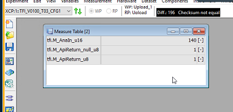{#toggle0186c2 .image-toggle style="width:2.3125in;height:1.1146in;border:none"}{.image-toggle-magnifier}](i35_edited.png){.imagetogglelink style="margin:0;width:2.3125in;height:1.1146in"}

 

24\. Finally, save the configuration.

 

 

   

     

 

 

     

 
